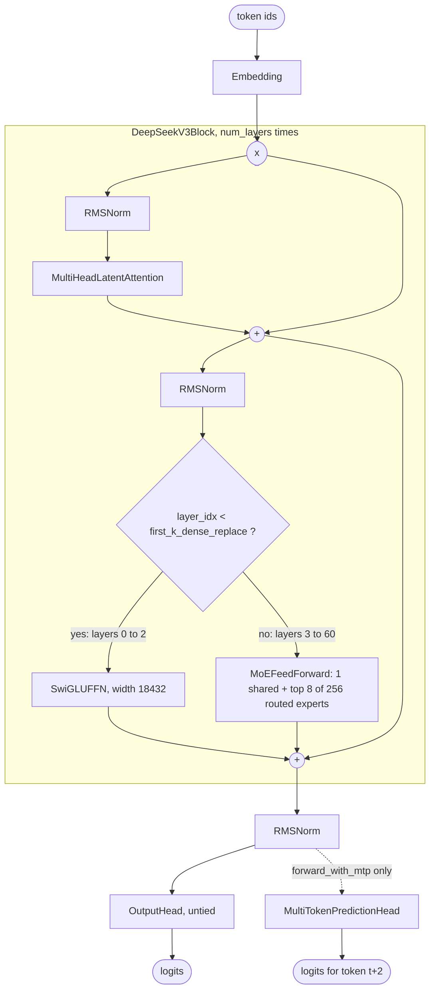
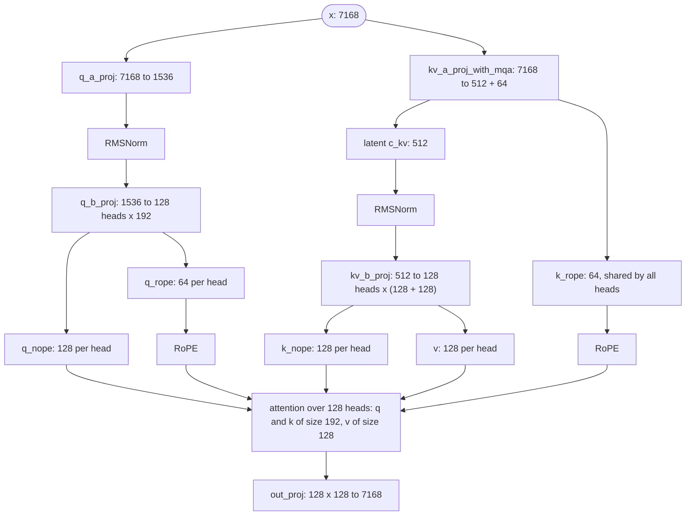

# DeepSeek-V3 Architecture

DeepSeek-V3 (DeepSeek-AI, December 2024; DeepSeek-R1 uses the same network) is a 671B-parameter mixture of experts that runs about 37B parameters per token. Three ideas define it: **Multi-head Latent Attention (MLA)**, which compresses keys and values into a small latent vector; a **DeepSeekMoE** feed-forward of one shared expert plus 256 fine-grained routed experts; and **auxiliary-loss-free load balancing**, which steers the router with a per-expert bias instead of a loss term. This guide walks through each in OLM's `DeepSeekV3Model` source, maps the arguments to the Hugging Face `config.json`, trains a tiny DeepSeek-V3 on a CPU with bias balancing and multi-token prediction, and lists where OLM differs from the release.

> [!NOTE]
> OLM presets are architectures with **randomly initialised weights**. `DeepSeekV3_671B()` builds the DeepSeek-V3 graph; it does not download DeepSeek's checkpoint. Build it on the `meta` device. See the [Model Zoo](index.md) for every preset and its measured size.

<div class="table-scroll">

| Preset | Release | Total (OLM) | Without the MTP head | Active per token (OLM) |
|---|---|--:|--:|--:|
| `DeepSeekV3_671B` | DeepSeek-V3, DeepSeek-R1 | 672.1B | 671.0B | 37.6B |

</div>

The release reports 671B parameters for the main model and 37B activated per token, plus 14B for its multi-token-prediction module. OLM's main model matches; its MTP head is a smaller design (1.03B), described [below](#multi-token-prediction).

## What changed from DeepSeek-V2

MLA and the DeepSeekMoE layout (shared experts plus many small routed experts) come from DeepSeek-V2. V3 keeps both and changes how the experts are chosen and trained:

<div class="table-scroll">

| | DeepSeek-V2 | DeepSeek-V3 |
|---|---|---|
| Routed experts per MoE layer | 160 | 256 |
| Shared experts | 2 | 1 |
| Routed experts per token | 6 | 8 |
| Router affinity | softmax | sigmoid, normalised over the chosen experts |
| Load balancing | auxiliary losses | a per-expert bias on the routing scores, plus a sequence-wise loss with a very small weight (0.0001) |
| Extra training objective | none | multi-token prediction (one extra token) |

</div>

- **Sigmoid affinities.** Each expert gets an independent score in (0, 1) instead of a share of a softmax. The chosen experts' scores are then normalised to sum to 1 and multiplied by `routed_scaling_factor` (2.5).
- **Auxiliary-loss-free balancing.** Each expert has a bias that is added to its score **only when choosing** the top 8 experts, not when weighting their outputs. The bias is set by a simple rule rather than by gradients. After each training step, the bias of an overloaded expert goes down and that of an underloaded expert goes up. The language-modelling loss never has to trade accuracy for balance.
- **Multi-token prediction (MTP).** An extra module predicts the token after next from the final hidden state and the next token's embedding. It adds a training signal and can serve as a draft model for speculative decoding; plain inference ignores it.

## Block diagram



Multi-head Latent Attention, for one token in the 671B preset:



The only per-token state attention needs from the past is the 512-value latent `c_kv` and the 64-value shared `k_rope`: 576 numbers per token per layer. Full multi-head attention with 128 heads of size 128 would keep 2 × 128 × 128 = 32,768 (keys and values). That is the point of MLA: a KV cache over 50 times smaller, at the cost of the up-projection `kv_b_proj`. OLM computes attention over the full sequence and has no KV cache, so in OLM the saving is visible only in the shapes.

## The source, section by section

DeepSeek-V3 lives in [`src/olm/models/deepseekai/deepseek_v3.py`](https://github.com/openlanguagemodel/openlanguagemodel/blob/main/src/olm/models/deepseekai/deepseek_v3.py), and builds on three shared modules: `MultiHeadLatentAttention`, `MoEFeedForward` with its `MoERouter`, and `MultiTokenPredictionHead`.

### Multi-head Latent Attention

The projections:

[`mla.py` lines 99–118](https://github.com/openlanguagemodel/openlanguagemodel/blob/main/src/olm/nn/attention/mla.py#L99-L118)

```python
# Query projection: optionally low-rank (down -> norm -> up).
if q_lora_rank is None:
    self.q_proj = Linear(embed_dim, num_heads * self.qk_head_dim, bias=bias)
else:
    self.q_a_proj = Linear(embed_dim, q_lora_rank, bias=bias)
    self.q_a_layernorm = RMSNorm(q_lora_rank, eps=rms_norm_eps)
    self.q_b_proj = Linear(
        q_lora_rank, num_heads * self.qk_head_dim, bias=bias
    )

# Key/value projection: down to a shared latent plus the decoupled rope key.
self.kv_a_proj_with_mqa = Linear(
    embed_dim, kv_lora_rank + qk_rope_head_dim, bias=bias
)
self.kv_a_layernorm = RMSNorm(kv_lora_rank, eps=rms_norm_eps)
self.kv_b_proj = Linear(
    kv_lora_rank, num_heads * (qk_nope_head_dim + v_head_dim), bias=bias
)

self.out_proj = Linear(num_heads * v_head_dim, embed_dim, bias=bias)
```

- **Queries are low-rank too.** `q_a_proj` compresses to `q_lora_rank` (1,536), `q_a_layernorm` normalises, and `q_b_proj` expands to every head. This saves activation memory in training; it does not affect the KV cache.
- **`kv_a_proj_with_mqa`** is the only key/value projection that reads `x`. Its output is the latent (`kv_lora_rank` = 512) plus one 64-dimensional rotary key shared by all heads, which is the "MQA" in its name.
- **`kv_b_proj`** expands the normalised latent into each head's non-rotary key (128) and value (128).

The forward pass:

[`mla.py` lines 181–213](https://github.com/openlanguagemodel/openlanguagemodel/blob/main/src/olm/nn/attention/mla.py#L181-L213)

```python
# --- Queries ---
if self.q_lora_rank is None:
    q = self.q_proj(x)
else:
    q = self.q_b_proj(self.q_a_layernorm(self.q_a_proj(x)))
q = q.view(B, N, self.num_heads, self.qk_head_dim)
q_nope, q_rope = torch.split(
    q, [self.qk_nope_head_dim, self.qk_rope_head_dim], dim=-1
)

# --- Keys / Values ---
kv = self.kv_a_proj_with_mqa(x)
compressed_kv, k_rope = torch.split(
    kv, [self.kv_lora_rank, self.qk_rope_head_dim], dim=-1
)
kv = self.kv_b_proj(self.kv_a_layernorm(compressed_kv))
kv = kv.view(B, N, self.num_heads, self.qk_nope_head_dim + self.v_head_dim)
k_nope, value = torch.split(
    kv, [self.qk_nope_head_dim, self.v_head_dim], dim=-1
)

# --- Decoupled RoPE ---
# Query rope part is per-head; key rope part is shared across heads (MQA).
q_rope = self.rope(q_rope)
k_rope = self.rope(k_rope.view(B, N, 1, self.qk_rope_head_dim))
k_rope = k_rope.expand(B, N, self.num_heads, self.qk_rope_head_dim)

# --- Assemble full query/key per head, then [B, N, H, D] -> [B, H, N, D] ---
q = torch.cat([q_nope, q_rope], dim=-1).transpose(1, 2)
k = torch.cat([k_nope, k_rope], dim=-1).transpose(1, 2)
value = value.transpose(1, 2)

attention_out = self.compute_attention(q, k, value, mask)
```

- **Decoupled RoPE.** RoPE cannot be applied to the latent, because a rotation that depends on position would stop the up-projection from being absorbed into the query at inference time. MLA therefore splits each head: `q_nope`/`k_nope` carry content and get no position, and a separate 64-dimensional `q_rope`/`k_rope` pair carries position.
- `k_rope` is computed once per token and `expand`ed to all 128 heads, so it costs 64 cached values, not 128 × 64.
- Each head's query and key are the concatenation `[nope, rope]` of size 192, so the default softmax scale is `192 ** -0.5`; values stay 128-dimensional.

### The decoder block

[`deepseek_v3.py` lines 68–105](https://github.com/openlanguagemodel/openlanguagemodel/blob/main/src/olm/models/deepseekai/deepseek_v3.py#L68-L105)

```python
super().__init__([])
self.use_moe = use_moe
self.attn_norm = RMSNorm(embed_dim, eps=rms_norm_eps)
self.self_attn = MultiHeadLatentAttention(
    embed_dim,
    num_heads,
    max_seq_len,
    kv_lora_rank=kv_lora_rank,
    qk_nope_head_dim=qk_nope_head_dim,
    qk_rope_head_dim=qk_rope_head_dim,
    v_head_dim=v_head_dim,
    q_lora_rank=q_lora_rank,
    dropout=dropout,
    rope_theta=rope_theta,
    rms_norm_eps=rms_norm_eps,
)
self.ffn_norm = RMSNorm(embed_dim, eps=rms_norm_eps)
self.last_router_logits = None

if use_moe:
    self.ffn = MoEFeedForward(
        embed_dim=embed_dim,
        expert_cls=SwiGLUFFN,
        num_experts=num_experts,
        num_shared_experts=num_shared_experts,
        top_k=top_k,
        expert_kwargs={"hidden_dim": moe_intermediate_size, "bias": False},
        scoring_func="sigmoid",
        routing_method="noaux_tc",
        use_router_bias=True,
        norm_weights=True,
        fp32_gate=True,
        routed_scaling_factor=routed_scaling_factor,
    )
else:
    self.ffn = SwiGLUFFN(
        embed_dim, hidden_dim=dense_intermediate_size, bias=False
    )
```

- **`use_moe`** picks the feed-forward. Dense layers get a wide `SwiGLUFFN` (18,432); MoE layers get `MoEFeedForward` with 256 `SwiGLUFFN` experts of width 2,048 and one shared expert of the same shape.
- The router is configured for V3: `scoring_func="sigmoid"`, `routing_method="noaux_tc"` (which adds the balancing bias), `norm_weights=True` (renormalise the chosen scores), `fp32_gate=True` (score in float32) and `routed_scaling_factor`.

[`deepseek_v3.py` lines 107–120](https://github.com/openlanguagemodel/openlanguagemodel/blob/main/src/olm/models/deepseekai/deepseek_v3.py#L107-L120)

```python
def forward(self, x: torch.Tensor, **kwargs) -> torch.Tensor:
    residual = x
    x = self.self_attn(
        self.attn_norm(x), **{k: v for k, v in kwargs.items() if k == "mask"}
    )
    x = residual + x

    residual = x
    if self.use_moe:
        x, router_logits = self.ffn(self.ffn_norm(x))
        self.last_router_logits = router_logits
    else:
        x = self.ffn(self.ffn_norm(x))
    return residual + x
```

`MoEFeedForward` returns a tuple `(output, router_logits)`, which the `Residual` combinator cannot handle, so the block has its own `forward`. It keeps the router logits on `self.last_router_logits` for auxiliary losses and forwards only a `mask` keyword to attention.

### Routing with a balancing bias

[`router.py` lines 100–127](https://github.com/openlanguagemodel/openlanguagemodel/blob/main/src/olm/nn/moe/router.py#L100-L127)

```python
logits = self.gate(x)

if self.fp32_gate:
    logits = logits.float()

router_logits = logits

if self.scoring_func == "sigmoid":
    scores = torch.sigmoid(logits)
else:
    scores = F.softmax(logits, dim=-1)

selection_scores = scores
if self.expert_bias is not None:
    selection_scores = scores + self.expert_bias

top_k_weights, top_k_indices = torch.topk(
    selection_scores, self.top_k, dim=-1
)

if self.scoring_func == "sigmoid":
    top_k_weights = scores.gather(-1, top_k_indices)

if self.norm_weights:
    top_k_weights = top_k_weights / top_k_weights.sum(dim=-1, keepdim=True)

if self.routed_scaling_factor != 1.0:
    top_k_weights = top_k_weights * self.routed_scaling_factor
```

Read it with `scoring_func="sigmoid"` and `routing_method="noaux_tc"`:

1. `scores = sigmoid(logits)`: an independent affinity per expert.
2. `selection_scores = scores + self.expert_bias`: the bias is added **for selection only**.
3. `topk` over `selection_scores` picks 8 experts.
4. `top_k_weights = scores.gather(...)`: the weights come from the unbiased scores, so the bias changes *which* experts run but never *how much* each contributes.
5. The 8 weights are normalised to sum to 1 and multiplied by `routed_scaling_factor`.

The bias is not learned by gradient descent (it gets no gradient, because the weights ignore it). It is updated from the load of the latest batch:

[`router.py` lines 152–180](https://github.com/openlanguagemodel/openlanguagemodel/blob/main/src/olm/nn/moe/router.py#L152-L180)

```python
@torch.no_grad()
def update_expert_bias_(
    self,
    expert_fraction: Optional[torch.Tensor] = None,
    target_fraction: Optional[torch.Tensor] = None,
    update_rate: float = 1e-3,
) -> None:
    """
    Apply an auxiliary-loss-free expert-bias update.

    Over-used experts receive a lower bias; under-used experts receive a
    higher bias. This mirrors the mechanism used by loss-free balancing
    methods while keeping the update explicit and opt-in.
    """
    if self.expert_bias is None:
        raise ValueError("Expert bias updates require routing_method='noaux_tc'")

    if expert_fraction is None:
        if self.last_stats is None:
            raise ValueError("No router stats available for bias update")
        expert_fraction = self.last_stats.expert_fraction

    expert_fraction = expert_fraction.to(self.expert_bias.device)
    if target_fraction is None:
        target_fraction = torch.full_like(expert_fraction, 1.0 / self.num_experts)
    else:
        target_fraction = target_fraction.to(self.expert_bias.device)

    self.expert_bias.add_(update_rate * (target_fraction - expert_fraction))
```

`expert_fraction` is the share of routing slots each expert received in the last forward pass. Experts above the uniform share `1 / num_experts` get a lower bias and are chosen less next time; experts below it get a higher bias. **Nothing calls this for you**: the `Trainer` does not, so call it after each optimizer step, as in the [training example](#train-a-tiny-deepseek-v3-on-your-cpu).

The shared expert and the routed experts then combine in `MoEFeedForward.forward`:

[`moe_ffn.py` lines 94–99](https://github.com/openlanguagemodel/openlanguagemodel/blob/main/src/olm/nn/moe/moe_ffn.py#L94-L99)

```python
shared_output = torch.zeros_like(x)
if self.shared_experts is not None:
    for expert in self.shared_experts:
        shared_output = shared_output + expert(x)

top_k_indices, top_k_weights, router_logits = self.router(x)
```

Every token passes through the shared expert; the router's 8 experts are added on top, each weighted by its routing weight.

### The model

[`deepseek_v3.py` lines 207–231](https://github.com/openlanguagemodel/openlanguagemodel/blob/main/src/olm/models/deepseekai/deepseek_v3.py#L207-L231)

```python
layers = nn.ModuleList(
    [
        DeepSeekV3Block(
            embed_dim,
            num_heads,
            max_seq_len,
            kv_lora_rank,
            qk_nope_head_dim,
            qk_rope_head_dim,
            v_head_dim,
            q_lora_rank,
            dense_intermediate_size,
            moe_intermediate_size,
            num_experts,
            num_shared_experts,
            top_k,
            use_moe=layer_idx >= first_k_dense_replace,
            routed_scaling_factor=routed_scaling_factor,
            dropout=dropout,
            rope_theta=rope_theta,
            rms_norm_eps=rms_norm_eps,
        )
        for layer_idx in range(num_layers)
    ]
)
```

`use_moe=layer_idx >= first_k_dense_replace` makes the first three layers dense and the other 58 MoE. The layers live in an `nn.ModuleList` and the model has its own `forward`, which passes keyword arguments such as `mask` on to every block.

### Multi-token prediction

[`deepseek_v3.py` lines 244–275](https://github.com/openlanguagemodel/openlanguagemodel/blob/main/src/olm/models/deepseekai/deepseek_v3.py#L244-L275)

```python
    self.mtp = (
        MultiTokenPredictionHead(
            embed_dim,
            vocab_size,
            num_heads=num_mtp_modules,
            rms_norm_eps=rms_norm_eps,
        )
        if num_mtp_modules > 0
        else None
    )

def forward(self, x: torch.Tensor, **kwargs) -> torch.Tensor:
    x = self.blocks[0](x)
    for block in self.transformer_blocks:
        x = block(x, **kwargs)
    x = self.blocks[1](x)
    return self.blocks[2](x)

def forward_with_mtp(self, x: torch.Tensor, **kwargs):
    """Return main logits and Multi-Token-Prediction auxiliary logits."""
    if self.mtp is None:
        raise ValueError("num_mtp_modules=0; this model has no MTP head")

    token_embeddings = self.blocks[0](x)
    hidden = token_embeddings
    for block in self.transformer_blocks:
        hidden = block(hidden, **kwargs)
    hidden = self.blocks[1](hidden)
    logits = self.blocks[2](hidden)

    mtp_logits = self.mtp(hidden, token_embeddings)
    return logits, mtp_logits
```

`forward` never touches `self.mtp`, so inference and a plain `Trainer` run ignore it. `forward_with_mtp` returns the normal logits plus a list of MTP logits. The head combines the final hidden state at position *t* with the embedding of token *t* + 1:

[`mtp.py` lines 86–106](https://github.com/openlanguagemodel/openlanguagemodel/blob/main/src/olm/nn/blocks/mtp.py#L86-L106)

```python
for i in range(self.num_heads):
    offset = i + 1
    if offset >= N:
        break

    shifted_emb = token_embeddings[:, offset:]
    truncated_hidden = prev_hidden[:, : N - offset]

    combined = torch.cat([truncated_hidden, shifted_emb], dim=-1)
    h = self.projections[i](combined)
    h = self.norms[i](h)

    if self.share_lm_head:
        logits = self.lm_head(h)
    else:
        logits = self.lm_heads[i](h)

    predictions.append(logits)
    prev_hidden = h

return predictions
```

So `mtp_logits[0][:, t]` has seen tokens up to *t* + 1 and predicts token *t* + 2. Each MTP module in the release instead runs a full transformer block between the projection and its output head and shares the main model's output head; OLM's head is a projection, an RMSNorm and its own output matrix (see [Known differences](#known-differences-from-the-reference)).

### The preset

[`deepseek_v3.py` lines 278–304](https://github.com/openlanguagemodel/openlanguagemodel/blob/main/src/olm/models/deepseekai/deepseek_v3.py#L278-L304)

```python
class DeepSeekV3_671B(DeepSeekV3Model):
    """DeepSeek-V3 / R1 (671B total, ~37B active; language-model component)."""

    def __init__(self):
        super().__init__(
            vocab_size=129280,
            embed_dim=7168,
            num_layers=61,
            num_heads=128,
            max_seq_len=163840,
            kv_lora_rank=512,
            qk_nope_head_dim=128,
            qk_rope_head_dim=64,
            v_head_dim=128,
            q_lora_rank=1536,
            dense_intermediate_size=18432,
            moe_intermediate_size=2048,
            num_experts=256,
            num_shared_experts=1,
            top_k=8,
            first_k_dense_replace=3,
            routed_scaling_factor=2.5,
            num_mtp_modules=1,
            rope_theta=10000.0,
            rms_norm_eps=1e-6,
            tie_weights=False,
        )
```

### Where the 671B parameters are, and the 37.6B a token uses

<div class="table-scroll">

| Part | Parameters |
|---|--:|
| Embedding, 129,280 × 7,168 | 926,679,040 |
| Output head (untied) | 926,679,040 |
| MLA per layer | 187,107,328 |
| Dense SwiGLU FFN (layers 0–2), 3 × 7,168 × 18,432 | 396,361,728 |
| One expert, 3 × 7,168 × 2,048 | 44,040,192 |
| MoE per layer: 256 routed + 1 shared expert + router | 11,320,164,864 |
| One MoE layer (MLA + MoE + 2 RMSNorms) | 11,507,286,528 |
| **Main model**: 3 dense + 58 MoE layers + embedding + head + final norm | **671,026,434,048** |
| MTP head (OLM's design) | 1,029,446,656 |
| **Active per token**: main model − 58 × 248 unused experts × 44,040,192 | **37,552,312,320** |

</div>

Of the MLA's 187M parameters, `out_proj` (128 × 128 → 7,168) alone is 117M; the latent projections that give MLA its small cache (`kv_a_proj_with_mqa` and `kv_b_proj`) are 21M together.

## Configuration: OLM and Hugging Face

Values for `DeepSeekV3_671B` next to the released [`config.json`](https://huggingface.co/deepseek-ai/DeepSeek-V3/blob/main/config.json). Bold rows differ.

<div class="table-scroll">

| OLM argument | Hugging Face key | `DeepSeekV3_671B` | Release |
|---|---|--:|--:|
| `vocab_size` | `vocab_size` | 129280 | 129280 |
| `embed_dim` | `hidden_size` | 7168 | 7168 |
| `num_layers` | `num_hidden_layers` | 61 | 61 |
| `num_heads` | `num_attention_heads` | 128 | 128 |
| `max_seq_len` | `max_position_embeddings` | 163840 | 163840 |
| `kv_lora_rank` | `kv_lora_rank` | 512 | 512 |
| `q_lora_rank` | `q_lora_rank` | 1536 | 1536 |
| `qk_nope_head_dim` | `qk_nope_head_dim` | 128 | 128 |
| `qk_rope_head_dim` | `qk_rope_head_dim` | 64 | 64 |
| `v_head_dim` | `v_head_dim` | 128 | 128 |
| `dense_intermediate_size` | `intermediate_size` | 18432 | 18432 |
| `moe_intermediate_size` | `moe_intermediate_size` | 2048 | 2048 |
| `num_experts` | `n_routed_experts` | 256 | 256 |
| `num_shared_experts` | `n_shared_experts` | 1 | 1 |
| `top_k` | `num_experts_per_tok` | 8 | 8 |
| `first_k_dense_replace` | `first_k_dense_replace` | 3 | 3 |
| `routed_scaling_factor` | `routed_scaling_factor` | 2.5 | 2.5 |
| `num_mtp_modules` | `num_nextn_predict_layers` | 1 | 1 |
| `rope_theta` | `rope_theta` | 10000.0 | 10000 |
| `rms_norm_eps` | `rms_norm_eps` | 1e-6 | 1e-6 |
| `tie_weights` | `tie_word_embeddings` | false | false |
| fixed in the block: `scoring_func="sigmoid"` | `scoring_func` | sigmoid | sigmoid |
| fixed in the block: `routing_method="noaux_tc"` | `topk_method` | noaux_tc | noaux_tc |
| fixed in the block: `norm_weights=True` | `norm_topk_prob` | true | true |
| **not supported** | **`n_group`, `topk_group`** | **—** | **8, 4** |
| **not applied (no argument in this family)** | **`rope_scaling`** | **none** | **YaRN, factor 40** |

</div>

## Train a tiny DeepSeek-V3 on your CPU

This example trains a four-layer DeepSeek-V3 (one dense layer, three MoE layers) with the three training-time pieces the architecture expects: the next-token loss, the MTP loss on the token after next, and the bias update after every step. It also adds the small sequence-wise balance loss the release trains with, computed from the router logits each block keeps.

```python
import torch
import torch.nn.functional as F
from olm.models import DeepSeekV3Model
from olm.train.losses import SequenceLoadBalanceLoss

torch.manual_seed(0)
num_experts, top_k = 8, 2
model = DeepSeekV3Model(
    vocab_size=256,
    embed_dim=64,
    num_layers=4,
    num_heads=4,
    max_seq_len=64,
    kv_lora_rank=16,
    qk_nope_head_dim=16,
    qk_rope_head_dim=8,
    v_head_dim=16,
    q_lora_rank=32,
    dense_intermediate_size=128,
    moe_intermediate_size=32,
    num_experts=num_experts,
    num_shared_experts=1,
    top_k=top_k,
    first_k_dense_replace=1,
    num_mtp_modules=1,
    tie_weights=False,  # untied, as in the release
)
print(f"{sum(p.numel() for p in model.parameters()):,} parameters")
moe_blocks = [block for block in model.transformer_blocks if block.use_moe]

# DeepSeek-V3's complementary sequence-wise balance loss uses alpha = 0.0001.
balance = SequenceLoadBalanceLoss(
    num_experts, top_k, coefficient=1e-4, scoring_func="sigmoid"
)
tokens = torch.randint(0, 256, (8, 33))
inputs, targets = tokens[:, :-1], tokens[:, 1:]
optimizer = torch.optim.AdamW(model.parameters(), lr=3e-3)

for step in range(30):
    logits, mtp_logits = model.forward_with_mtp(inputs)
    lm_loss = F.cross_entropy(logits.flatten(0, 1), targets.flatten())
    # mtp_logits[0][:, t] predicts token t + 2, which is targets[:, t + 1].
    mtp_loss = F.cross_entropy(mtp_logits[0].flatten(0, 1), targets[:, 1:].flatten())
    aux_loss = sum(
        balance(block.last_router_logits, block.ffn.router.last_stats.top_k_indices)
        for block in moe_blocks
    )
    loss = lm_loss + 0.3 * mtp_loss + aux_loss
    optimizer.zero_grad()
    loss.backward()
    optimizer.step()
    # Auxiliary-loss-free balancing: nudge each expert's bias toward even load.
    for block in moe_blocks:
        block.ffn.router.update_expert_bias_(update_rate=1e-2)
    if step % 10 == 0 or step == 29:
        print(f"step {step:2d}  lm {lm_loss.item():.3f}  mtp {mtp_loss.item():.3f}")

router = moe_blocks[0].ffn.router
print("load  ", [round(f, 3) for f in router.last_stats.expert_fraction.tolist()])
print("bias  ", [round(b, 4) for b in router.expert_bias.tolist()])
```

Output on a CPU with PyTorch 2.12 (values vary slightly across versions and hardware):

```text
301,424 parameters
step  0  lm 5.705  mtp 5.730
step 10  lm 2.281  mtp 3.230
step 20  lm 0.693  mtp 1.586
step 29  lm 0.226  mtp 0.601
load   [0.178, 0.123, 0.111, 0.129, 0.105, 0.104, 0.105, 0.145]
bias   [-0.0161, -0.0007, 0.009, -0.0059, 0.0057, 0.0105, 0.0077, -0.0101]
```

The MTP loss falls more slowly than the next-token loss: predicting two tokens ahead is harder. The last two lines show the balancing at work in the first MoE layer. Expert 0 received the largest share of routing slots (0.178, against an even 0.125) and has the most negative bias, so it will be picked less often; the least-used experts have positive biases. The `0.3` weight on the MTP loss is the value the DeepSeek-V3 report uses for most of pretraining.

## Known differences from the reference

- **No group-limited routing.** The release first scores 8 groups of 32 experts, keeps the best 4 groups (`n_group: 8`, `topk_group: 4`) and picks the top 8 experts from those. OLM picks the top 8 of all 256 directly. The group limit bounds how many devices a token's experts span in the release's expert-parallel training; OLM has no expert parallelism.
- **A gate bias the release does not have.** `DeepSeekV3Block` passes `use_router_bias=True`, which gives the router's gate `Linear` a learned bias (256 parameters per MoE layer). The release's gate has no bias; its only bias is the balancing term, which OLM keeps separately as `expert_bias`.
- **Bias update rule.** The DeepSeek-V3 report lowers an overloaded expert's bias and raises an underloaded one's by a fixed step γ, using only the sign of the imbalance. `update_expert_bias_` moves each bias in proportion to its imbalance, `update_rate * (1 / num_experts - fraction)`. In both, it is a manual step outside the optimizer.
- **No YaRN.** The release extends RoPE with YaRN (`rope_scaling.type: "yarn"`, factor 40 from a 4,096-token original context). Its attention also multiplies the softmax scale by `mscale²`, with `mscale = 0.1 · ln(40) + 1` (about 1.87 in total). OLM uses plain RoPE and the unscaled `192 ** -0.5`. The docstring of `DeepSeekV3Model` notes the RoPE simplification. OLM does have a `yarn` mode in `ScaledRotaryPositionalEmbedding` (`olm/nn/embeddings/positional/rope.py`), but `MultiHeadLatentAttention` always builds plain `RotaryPositionalEmbedding`.
- **A simpler MTP module.** The release's MTP module normalises the hidden state and the embedding, projects their concatenation, runs a full transformer block (with MoE) and reuses the main output head; the released checkpoint lists 14B parameters for its MTP module. OLM's `MultiTokenPredictionHead` projects the concatenation, applies an RMSNorm and uses its own untied output matrix, 1.03B parameters.
- **Reading-first MoE.** Experts run in a Python loop over the tokens each one received: correct and readable, much slower than production grouped-GEMM kernels, and with no expert parallelism or FP8 training (the release was trained in FP8).
- **Initialisation.** OLM uses PyTorch's default initialisers; the release config specifies `initializer_range: 0.02`.

## Further reading

- *DeepSeek-V3 Technical Report*, DeepSeek-AI, 2024. [arXiv:2412.19437](https://arxiv.org/abs/2412.19437)
- *DeepSeek-V2: A Strong, Economical, and Efficient Mixture-of-Experts Language Model*, DeepSeek-AI, 2024, which introduces MLA and DeepSeekMoE. [arXiv:2405.04434](https://arxiv.org/abs/2405.04434)
- *Auxiliary-Loss-Free Load Balancing Strategy for Mixture-of-Experts*, Wang et al., 2024. [arXiv:2408.15664](https://arxiv.org/abs/2408.15664)
- Previous: [Qwen3](qwen-3.md), a softmax-routed MoE with an auxiliary loss. Next: [Kimi K2 and Kimi Linear](kimi.md), which scale this design up and then replace most of its attention.

<!-- model-zoo: DeepSeekV3Model -->
