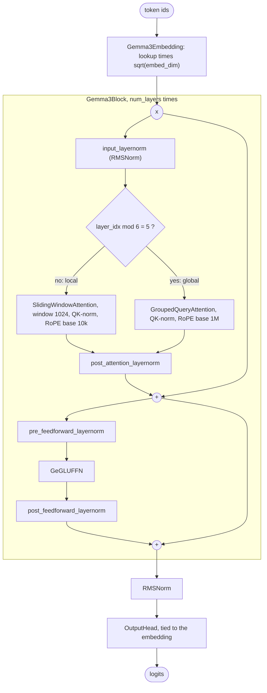

# Gemma 3 Architecture

Gemma 3 (Google DeepMind, 2025) is a dense decoder built for long context on modest hardware. Five of every six layers attend only to the last 1,024 tokens; the sixth attends to everything. Each sublayer is wrapped in two RMSNorms, and QK-norm replaces Gemma 2's logit soft-capping. This guide walks through OLM's `Gemma3Model` line by line, maps every argument to the Hugging Face `config.json`, trains a tiny Gemma 3 on a CPU, and lists where OLM differs from Google's release.

> [!NOTE]
> OLM presets are architectures with **randomly initialised weights**. `Gemma3_27B()` builds the language model of Gemma 3 27B; it does not download Google's checkpoint, and it has no vision encoder. See the [Model Zoo](index.md) for every preset and its measured size.

<div class="table-scroll">

| Preset | Release | Total parameters (OLM) | Local / global layers |
|---|---|--:|--:|
| `Gemma3_4B` | Gemma 3 4B (language model) | 3.88B | 29 / 5 |
| `Gemma3_27B` | Gemma 3 27B (language model) | 27.0B | 52 / 10 |

</div>

## What changed from Gemma 2

OLM's `Gemma2Model` and `Gemma3Model` show the changes directly:

<div class="table-scroll">

| | Gemma 2 (`gemma2.py`) | Gemma 3 (`gemma3.py`) |
|---|---|---|
| Local : global layers | 1 : 1, alternating | 5 : 1 |
| Sliding window | 4,096 tokens | 1,024 tokens |
| Stabilising attention | tanh soft-cap on attention logits (50.0) and on final logits (30.0) | QK-norm, no soft-caps |
| RoPE base | 10,000 for every layer | 10,000 for local layers, 1,000,000 for global layers |
| Context (`max_seq_len`) | 8,192 | 131,072 |

</div>

- **Far fewer global layers.** A sliding-window layer only needs keys and values for the last `sliding_window` tokens, so its KV cache stops growing with the context. With five local layers per global one and a 1,024-token window, most of the model's KV cache stays bounded as the context grows to 128K tokens. The Gemma 3 report introduces the change to cut the KV-cache memory of long contexts.
- **QK-norm instead of soft-capping.** Gemma 2 squashed attention logits with `50 * tanh(logits / 50)`. Gemma 3 normalises each query and key head instead (the same QK-norm as [Qwen3](qwen-3.md)), which bounds the logits without a `tanh`.
- **Two RoPE bases.** Local layers only see nearby tokens and keep base 10,000. Global layers use base 1,000,000, so their rotations stay distinguishable across long distances.
- **Unchanged:** the "sandwich" normalisation (an RMSNorm before and after each sublayer), the GeGLU feed-forward, the embedding scaled by √`embed_dim`, and the tied output head.

## Block diagram



## The source, section by section

Gemma 3 lives in [`src/olm/models/google/gemma3.py`](https://github.com/openlanguagemodel/openlanguagemodel/blob/main/src/olm/models/google/gemma3.py). Unlike [Llama 3](llama-3.md), it needs custom `forward` methods, because the block is built from named sublayers rather than `Residual` combinators.

### The scaled embedding

[`gemma3.py` lines 15–23](https://github.com/openlanguagemodel/openlanguagemodel/blob/main/src/olm/models/google/gemma3.py#L15-L23)

```python
class Gemma3Embedding(Embedding):
    """Gemma 3 token embedding with hidden-size scaling (same as Gemma 2)."""

    def __init__(self, vocab_size: int, embedding_dim: int):
        super().__init__(vocab_size, embedding_dim)
        self.embed_scale = math.sqrt(embedding_dim)

    def forward(self, x):
        return super().forward(x) * self.embed_scale
```

Gemma multiplies token embeddings by √`embed_dim` (√5,376 ≈ 73.3 at 27B), a convention that goes back to the original Transformer, which also shared its embedding with the output layer. The head reuses the unscaled matrix; only the input side is scaled. Subclassing `Embedding` keeps the scaled embedding at `model.blocks[0]`, where the tied `OutputHead` finds its weight.

### The decoder block

[`gemma3.py` lines 58–92](https://github.com/openlanguagemodel/openlanguagemodel/blob/main/src/olm/models/google/gemma3.py#L58-L92)

```python
super().__init__([])
self.input_layernorm = RMSNorm(embed_dim, eps=rms_norm_eps)
if is_local:
    self.self_attn = SlidingWindowAttention(
        embed_dim,
        num_heads,
        num_kv_heads,
        max_seq_len,
        window_size=sliding_window,
        head_dim=head_dim,
        dropout=dropout,
        rope_theta=local_rope_theta,
        use_qk_norm=True,
        rms_norm_eps=rms_norm_eps,
        use_bias=False,
    )
else:
    self.self_attn = GroupedQueryAttention(
        embed_dim,
        num_heads,
        num_kv_heads,
        max_seq_len,
        head_dim=head_dim,
        dropout=dropout,
        rope_theta=global_rope_theta,
        use_qk_norm=True,
        rms_norm_eps=rms_norm_eps,
        use_bias=False,
    )
self.post_attention_layernorm = RMSNorm(embed_dim, eps=rms_norm_eps)
self.pre_feedforward_layernorm = RMSNorm(embed_dim, eps=rms_norm_eps)
self.mlp = GeGLUFFN(
    embed_dim, hidden_dim=intermediate_size, dropout=dropout, bias=False
)
self.post_feedforward_layernorm = RMSNorm(embed_dim, eps=rms_norm_eps)
```

- **`is_local` chooses the attention class.** Local layers get `SlidingWindowAttention` with `window_size=sliding_window` and the local RoPE base; global layers get `GroupedQueryAttention` with the global base. Both take `use_qk_norm=True` and an explicit `head_dim` (256 at 4B, 128 at 27B, neither equal to `embed_dim // num_heads`).
- **Four RMSNorms per block**, named as in the Hugging Face implementation: `input_layernorm` and `post_attention_layernorm` around attention, `pre_feedforward_layernorm` and `post_feedforward_layernorm` around the MLP.
- **`GeGLUFFN`** is the gated FFN with GELU in place of SiLU: `down_proj(value * GELU(gate))`.

[`gemma3.py` lines 94–105](https://github.com/openlanguagemodel/openlanguagemodel/blob/main/src/olm/models/google/gemma3.py#L94-L105)

```python
def forward(self, x):
    residual = x
    x = self.input_layernorm(x)
    x = self.self_attn(x)
    x = self.post_attention_layernorm(x)
    x = residual + x

    residual = x
    x = self.pre_feedforward_layernorm(x)
    x = self.mlp(x)
    x = self.post_feedforward_layernorm(x)
    return residual + x
```

This is the sandwich norm: `x + post_norm(sublayer(pre_norm(x)))`. The extra norm on the sublayer output keeps what each layer adds to the residual stream at a controlled scale, whatever the attention or MLP produced. The same computation could be written as `Residual(Block([RMSNorm, attention, RMSNorm]))`.

`SlidingWindowAttention` builds its mask from the window and ANDs it with the causal mask, so token *i* attends to tokens *i* − 1,023 to *i*:

[`sliding_window.py` lines 111–117](https://github.com/openlanguagemodel/openlanguagemodel/blob/main/src/olm/nn/attention/sliding_window.py#L111-L117)

```python
def _build_sliding_window_mask(self, seq_len: int, device: torch.device) -> torch.Tensor:
    """Build a causal sliding-window boolean mask ``[seq_len, seq_len]``."""
    row = torch.arange(seq_len, device=device)
    col = torch.arange(seq_len, device=device)
    causal = row.unsqueeze(1) >= col.unsqueeze(0)
    window = (row.unsqueeze(1) - col.unsqueeze(0)) < self.window_size
    return causal & window
```

### The model

[`gemma3.py` lines 165–206](https://github.com/openlanguagemodel/openlanguagemodel/blob/main/src/olm/models/google/gemma3.py#L165-L206)

```python
    embedding = Gemma3Embedding(vocab_size, embed_dim)

    # 5 local (sliding-window) layers followed by 1 global (full) layer.
    layers = nn.ModuleList(
        [
            Gemma3Block(
                embed_dim,
                intermediate_size,
                num_heads,
                num_kv_heads,
                head_dim,
                max_seq_len,
                dropout,
                is_local=(
                    layer_idx % sliding_window_pattern != sliding_window_pattern - 1
                ),
                sliding_window=sliding_window,
                local_rope_theta=local_rope_theta,
                global_rope_theta=global_rope_theta,
                rms_norm_eps=rms_norm_eps,
            )
            for layer_idx in range(num_layers)
        ]
    )
    final_norm = RMSNorm(embed_dim, eps=rms_norm_eps)
    output_head = OutputHead(
        embed_dim,
        vocab_size,
        tied_embedding=embedding,
        tie_weights=tie_weights,
        use_norm=False,
    )

    super().__init__([embedding, final_norm, output_head])
    self.transformer_blocks = layers

def forward(self, x):
    x = self.blocks[0](x)
    for block in self.transformer_blocks:
        x = block(x)
    x = self.blocks[1](x)
    return self.blocks[2](x)
```

- **`is_local=(layer_idx % sliding_window_pattern != sliding_window_pattern - 1)`** makes layers 5, 11, 17, … global and all others local. With `sliding_window_pattern=6` that is five local layers, then one global.
- The layers are an `nn.ModuleList` on `self.transformer_blocks`, and `forward` runs embedding, layers, final norm and head by hand. `model.blocks` still holds `[embedding, final_norm, output_head]`.
- `OutputHead(..., tie_weights=tie_weights)` keeps the default `tie_weights=True`: Gemma 3 ties its output head to the embedding, and the presets do not change it.

### A preset

[`gemma3.py` lines 227–242](https://github.com/openlanguagemodel/openlanguagemodel/blob/main/src/olm/models/google/gemma3.py#L227-L242)

```python
class Gemma3_27B(Gemma3Model):
    """Gemma 3 27B Model (text-only language-model component)."""

    def __init__(self):
        super().__init__(
            vocab_size=262144,
            embed_dim=5376,
            intermediate_size=21504,
            num_layers=62,
            num_heads=32,
            num_kv_heads=16,
            head_dim=128,
            max_seq_len=131072,
            sliding_window=1024,
            sliding_window_pattern=6,
        )
```

The presets leave `local_rope_theta`, `global_rope_theta` and `rms_norm_eps` at the base-class defaults (10,000, 1,000,000 and 1e-6), which are Gemma 3's values.

## Configuration: OLM and Hugging Face

Values for `Gemma3_27B` next to the `text_config` of the released [`config.json`](https://huggingface.co/google/gemma-3-27b-pt/blob/main/config.json). Bold rows differ.

<div class="table-scroll">

| OLM argument | Hugging Face key (`text_config`) | `Gemma3_27B` | Release |
|---|---|--:|--:|
| **`vocab_size`** | **`vocab_size`** | **262144** | **262208** |
| `embed_dim` | `hidden_size` | 5376 | 5376 |
| `intermediate_size` | `intermediate_size` | 21504 | 21504 |
| `num_layers` | `num_hidden_layers` | 62 | 62 |
| `num_heads` | `num_attention_heads` | 32 | 32 |
| `num_kv_heads` | `num_key_value_heads` | 16 | 16 |
| `head_dim` | `head_dim` | 128 | 128 |
| `max_seq_len` | `max_position_embeddings` | 131072 | 131072 |
| `local_rope_theta` | `rope_local_base_freq` | 10000.0 | 10000.0 |
| `global_rope_theta` | `rope_theta` | 1000000.0 | 1000000.0 |
| `sliding_window` | `sliding_window` | 1024 | 1024 |
| `sliding_window_pattern` | `sliding_window_pattern` | 6 | 6 |
| `rms_norm_eps` | `rms_norm_eps` | 1e-6 | 1e-6 |
| `tie_weights` | `tie_word_embeddings` (unset, defaults to true) | true | true |
| fixed: no soft-caps | `attn_logit_softcapping`, `final_logit_softcapping` | none | null |
| **fixed: scale `head_dim ** -0.5`** | **`query_pre_attn_scalar`** | **128** | **168** |
| **not supported** | **`rope_scaling`** (global layers) | **none** | **linear, factor 8.0** |
| **fixed: exact GELU** | **`hidden_activation`** | **`gelu`** | **`gelu_pytorch_tanh`** |

</div>

For `Gemma3_4B`, `query_pre_attn_scalar` is 256, equal to its `head_dim`, so the attention scale matches. The other bold rows apply to both presets.

## Train a tiny Gemma 3 on your CPU

Shrink the window and the pattern so the local/global split shows up in a three-layer model: with `sliding_window_pattern=3`, layers 0 and 1 are local and layer 2 is global.

```python
import torch
import torch.nn.functional as F
from olm.models import Gemma3Model

torch.manual_seed(0)
model = Gemma3Model(
    vocab_size=256,
    embed_dim=64,
    intermediate_size=128,
    num_layers=3,
    num_heads=4,
    num_kv_heads=2,
    head_dim=16,
    max_seq_len=64,
    sliding_window=8,  # local layers see the last 8 tokens
    sliding_window_pattern=3,  # every third layer is global
)
print(f"{sum(p.numel() for p in model.parameters()):,} parameters")
for i, block in enumerate(model.transformer_blocks):
    print(i, type(block.self_attn).__name__)

tokens = torch.randint(0, 256, (8, 33))
inputs, targets = tokens[:, :-1], tokens[:, 1:]
optimizer = torch.optim.AdamW(model.parameters(), lr=3e-3)

for step in range(30):
    logits = model(inputs)
    loss = F.cross_entropy(logits.flatten(0, 1), targets.flatten())
    optimizer.zero_grad()
    loss.backward()
    optimizer.step()
    if step % 10 == 0 or step == 29:
        print(f"step {step:2d}  loss {loss.item():.3f}")
```

Output on a CPU with PyTorch 2.12 (losses vary slightly across versions and hardware):

```text
127,904 parameters
0 SlidingWindowAttention
1 SlidingWindowAttention
2 GroupedQueryAttention
step  0  loss 61.160
step 10  loss 34.675
step 20  loss 19.936
step 29  loss 10.420
```

The loss starts far above ln(256) ≈ 5.55 because of the initialisation, not the architecture: the tied head reuses an embedding drawn from PyTorch's default N(0, 1), so the first logits are large (see [Known differences](#known-differences-from-the-reference)).

## Known differences from the reference

- **Language model only.** The Gemma 3 4B and 27B releases are multimodal (`Gemma3ForConditionalGeneration` with a SigLIP vision encoder). The presets build the text decoder alone, which is why `Gemma3_4B` counts 3.88B.
- **Vocabulary size.** The presets use 262,144 tokens; the released `text_config` has 262,208. The extra 64 ids start at the image token (`image_token_index: 262144` in the same config).
- **Attention scale.** OLM scales attention logits by `head_dim ** -0.5`. The release uses `query_pre_attn_scalar ** -0.5`, and for 27B `query_pre_attn_scalar` is 168 (= 5,376 / 32), not the head size 128. `GroupedQueryAttention` accepts an `attention_scale` argument and `Gemma2Block` passes it, but `Gemma3Block` does not.
- **No RoPE scaling on global layers.** The release applies linear RoPE scaling with factor 8.0 to the global layers (`rope_scaling` applies to full-attention layers only). OLM uses plain RoPE with base 1,000,000.
- **Exact GELU.** `GeGLUFFN` uses exact (erf) GELU; the release uses the tanh approximation (`gelu_pytorch_tanh`).
- **RMSNorm parameterisation.** Gemma's RMSNorm stores a zero-initialised weight and multiplies by `1 + weight`; OLM's stores the scale itself, initialised to one. The two compute the same function at initialisation, but weight decay on norm parameters pulls Gemma's scale toward 1 and OLM's toward 0.
- **Attention masks are ignored.** `Gemma3Model.forward(x)` and `Gemma3Block.forward(x)` take no `mask` argument, so a padding mask cannot be passed through; attention is always causal (plus the window on local layers).
- **Initialisation.** OLM uses PyTorch's default initialisers. The output head is tied to an embedding drawn from N(0, 1), so a new model starts with large logits (see the first loss above). The release config specifies `initializer_range: 0.02`.

## Further reading

- *Gemma 3 Technical Report*, Gemma Team, Google DeepMind, 2025. [arXiv:2503.19786](https://arxiv.org/abs/2503.19786)
- *Gemma 2: Improving Open Language Models at a Practical Size*, Gemma Team, 2024. [arXiv:2408.00118](https://arxiv.org/abs/2408.00118)
- Previous: [Qwen3](qwen-3.md), which also uses QK-norm. Next: [DeepSeek-V3](deepseek-v3.md).

<!-- model-zoo: Gemma3Model -->
