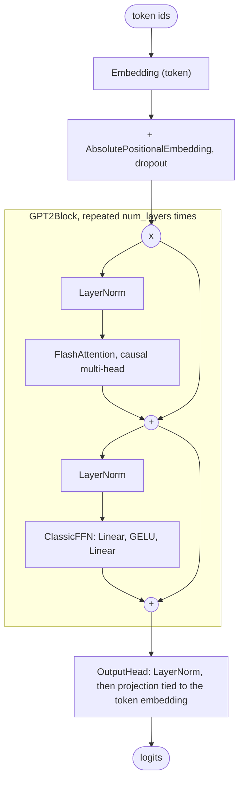

# GPT-2 Architecture

GPT-2 (OpenAI, 2019) is the decoder-only transformer most later models started from: learned position embeddings, pre-norm blocks of multi-head attention and a GELU MLP, LayerNorm, and an output head tied to the token embedding. This guide walks through OLM's `GPT2Model` line by line, maps every argument to the Hugging Face `config.json`, trains a tiny GPT-2 on a CPU, and lists where OLM differs from OpenAI's release.

> [!NOTE]
> OLM presets are architectures with **randomly initialised weights**. `GPT2()` builds the 124M GPT-2 graph; it does not download OpenAI's checkpoint. See the [Model Zoo](index.md) for every preset and its measured size.

<div class="table-scroll">

| Preset | Release | Total parameters (OLM) |
|---|---|--:|
| `GPT2` | GPT-2 small | 124,439,808 |
| `GPT2Medium` | GPT-2 medium | 354,823,168 |
| `GPT2Large` | GPT-2 large | 774,030,080 |
| `GPT2XL` | GPT-2 XL | 1,557,611,200 |

</div>

Each count is identical to the parameter count of Hugging Face's `GPT2LMHeadModel` built from the same configuration.

## What changed from GPT

The GPT-2 paper describes its model as the original GPT with a few changes, all of which are about the layout rather than the layer types:

- **Pre-norm.** Layer normalisation moved from after each sub-block to its input: `x + Attn(LN(x))` instead of `LN(x + Attn(x))`. Pre-norm keeps an unnormalised path from the embedding to the output, which makes deep stacks easier to train.
- **A final LayerNorm** after the last block, before the vocabulary projection. In OLM it is the `LayerNorm` inside `OutputHead`.
- **A residual-aware initialisation** that scales the weights of residual layers by 1/√N, where N is the number of residual layers. OLM does not apply it (see [Known differences](#known-differences-from-the-reference)).
- **A 50,257-token byte-level BPE vocabulary and a 1,024-token context**, up from 512.

What later models changed in turn is a good map of the rest of this section: [Llama 3](llama-3.md) replaces learned positions with RoPE, LayerNorm with RMSNorm, the GELU MLP with SwiGLU, full multi-head attention with grouped-query attention, and drops the biases.

## Block diagram



Each `+` adds a sublayer's input back to its output (a residual connection).

## The source, section by section

GPT-2 lives in [`src/olm/models/openai/gpt2.py`](https://github.com/openlanguagemodel/openlanguagemodel/blob/main/src/olm/models/openai/gpt2.py): a block, a model, and four presets.

### The decoder block

[`gpt2.py` lines 22–32](https://github.com/openlanguagemodel/openlanguagemodel/blob/main/src/olm/models/openai/gpt2.py#L22-L32)

```python
def __init__(self, embed_dim: int, num_heads: int, dropout: float = 0.1):
    super().__init__([
        Residual(Block([
            LayerNorm(embed_dim),
            FlashAttention(embed_dim, num_heads, dropout=dropout, causal=True)
        ])),
        Residual(Block([
            LayerNorm(embed_dim),
            ClassicFFN(embed_dim, dropout=dropout)
        ]))
    ])
```

- **`Residual(Block([LayerNorm, sublayer]))`** is the pre-norm pattern from the paper, written as data: `Block` runs its children in order and `Residual` adds the input back.
- **`FlashAttention(embed_dim, num_heads, dropout=dropout, causal=True)`** is multi-head attention with separate query, key, value and output projections (each with a bias, as in GPT-2). It calls PyTorch's `scaled_dot_product_attention`, which picks a fused kernel when one is available. `causal=True` is required for a language model: `FlashAttention` defaults to bidirectional attention.
- **`ClassicFFN(embed_dim, dropout=dropout)`** is `Linear(embed_dim, 4 * embed_dim)`, GELU, `Linear(4 * embed_dim, embed_dim)`, then dropout. The 4× width is `ClassicFFN`'s default.

### The model

[`gpt2.py` lines 46–61](https://github.com/openlanguagemodel/openlanguagemodel/blob/main/src/olm/models/openai/gpt2.py#L46-L61)

```python
def __init__(self, vocab_size: int, embed_dim: int, num_layers: int, num_heads: int, max_seq_len: int, dropout: float = 0.1, tie_weights: bool = True):
    token_embedding = Embedding(vocab_size, embed_dim)

    super().__init__([
        Block([
            token_embedding,
            AbsolutePositionalEmbedding(max_seq_len, embed_dim, dropout)
        ]),
        Repeat(lambda: GPT2Block(embed_dim, num_heads, dropout), num_layers),
        OutputHead(
            embed_dim,
            vocab_size,
            tied_embedding=token_embedding,
            tie_weights=tie_weights,
        )
    ])
```

- **The first child is itself a `Block`** of the token embedding and `AbsolutePositionalEmbedding`, which adds a learned vector per position and applies dropout (shown below).
- **`Repeat(lambda: GPT2Block(...), num_layers)`** builds `num_layers` independent blocks.
- **`OutputHead(embed_dim, vocab_size, tied_embedding=token_embedding, ...)`** keeps its default `use_norm=True`, so it applies GPT-2's final LayerNorm before projecting (shown below). The projection reuses the token embedding matrix (`tie_weights=True`), as GPT-2 does.
- `dropout` defaults to 0.1, GPT-2's value, and is used for the embeddings, the attention probabilities and the MLP output.

The learned positions are a lookup table with `max_seq_len` rows, added to the token embeddings:

[`absolute.py` lines 58–68](https://github.com/openlanguagemodel/openlanguagemodel/blob/main/src/olm/nn/embeddings/positional/absolute.py#L58-L68)

```python
if seq_positions is None:
    # default: positions 0, 1, 2, ..., seq_len-1
    positions = torch.arange(seq_len, dtype=torch.long, device=x.device)
    positions = positions.unsqueeze(0).expand(b, seq_len)  # (b, seq_len)
else:
    positions = seq_positions

# get positional embeddings and add to input
pos_embed = self.pos_embedding(positions)  # (b, seq_len, embed_dim)
x = x + pos_embed
x = self.dropout(x)
```

A GPT-2 therefore cannot read more than 1,024 tokens: a longer input makes the embedding raise a `ValueError`.

The final LayerNorm is the norm that `OutputHead` builds when it is not given one:

[`output_head.py` lines 121–124](https://github.com/openlanguagemodel/openlanguagemodel/blob/main/src/olm/nn/blocks/output_head.py#L121-L124)

```python
if norm is None:
    norm = LayerNorm(embed_dim) if use_norm else nn.Identity()

super().__init__([norm, projection])
```

### A preset

[`gpt2.py` lines 63–72](https://github.com/openlanguagemodel/openlanguagemodel/blob/main/src/olm/models/openai/gpt2.py#L63-L72)

```python
class GPT2(GPT2Model):
    """GPT-2 Small (124M)."""
    def __init__(self):
        super().__init__(
            vocab_size=50257,
            embed_dim=768,
            num_layers=12,
            num_heads=12,
            max_seq_len=1024
        )
```

The four sizes differ only in width, depth and head count; every size uses 64-dimensional heads.

## Configuration: OLM and Hugging Face

Values for `GPT2` next to the released [`gpt2` `config.json`](https://huggingface.co/openai-community/gpt2/blob/main/config.json). Bold rows differ.

<div class="table-scroll">

| OLM argument | Hugging Face key | `GPT2` | Release |
|---|---|--:|--:|
| `vocab_size` | `vocab_size` | 50257 | 50257 |
| `embed_dim` | `n_embd` | 768 | 768 |
| `num_layers` | `n_layer` | 12 | 12 |
| `num_heads` | `n_head` | 12 | 12 |
| `max_seq_len` | `n_positions` | 1024 | 1024 |
| `dropout` | `embd_pdrop`, `attn_pdrop`, `resid_pdrop` | 0.1 | 0.1 |
| fixed: `ClassicFFN` default `4 * embed_dim` | `n_inner` (unset, so `4 * n_embd`) | 3072 | 3072 |
| fixed: `LayerNorm` default `eps=1e-5` | `layer_norm_epsilon` | 1e-5 | 1e-5 |
| `tie_weights` | `tie_word_embeddings` (unset, defaults to true) | true | true |
| **fixed: GELU, exact (erf)** | **`activation_function`** | **`gelu`** | **`gelu_new` (tanh approximation)** |

</div>

## Train a tiny GPT-2 on your CPU

```python
import torch
import torch.nn.functional as F
from olm.models import GPT2Model

torch.manual_seed(0)
model = GPT2Model(
    vocab_size=256,
    embed_dim=64,
    num_layers=2,
    num_heads=4,
    max_seq_len=64,
    dropout=0.0,  # GPT-2 used 0.1; off here so the tiny run is deterministic
)
print(f"{sum(p.numel() for p in model.parameters()):,} parameters")

tokens = torch.randint(0, 256, (8, 33))
inputs, targets = tokens[:, :-1], tokens[:, 1:]  # predict the next token
optimizer = torch.optim.AdamW(model.parameters(), lr=3e-3)

for step in range(30):
    logits = model(inputs)  # [8, 32, 256]
    loss = F.cross_entropy(logits.flatten(0, 1), targets.flatten())
    optimizer.zero_grad()
    loss.backward()
    optimizer.step()
    if step % 10 == 0 or step == 29:
        print(f"step {step:2d}  loss {loss.item():.3f}")
```

Output on a CPU with PyTorch 2.12 (losses vary slightly across versions and hardware):

```text
120,576 parameters
step  0  loss 43.689
step 10  loss 12.954
step 20  loss 7.652
step 29  loss 5.436
```

The first loss is far above ln(256) ≈ 5.55, the loss of a uniform guess. That is the initialisation, not a bug in the block: the tied head reuses an embedding drawn from PyTorch's default N(0, 1), so the first logits are large (see [Known differences](#known-differences-from-the-reference)). The loss still falls steadily. To train on real text, pass the model to OLM's `Trainer` as in [Your First Language Model](../tutorials/first-model.md).

## Known differences from the reference

- **Exact GELU.** `ClassicFFN` uses `nn.GELU(approximate="none")`. The released GPT-2 used the tanh approximation (`activation_function: "gelu_new"`). The two are close but not identical, so the same weights would not give exactly the same logits.
- **No attention output dropout.** Hugging Face's GPT-2 applies `resid_pdrop` dropout after the attention output projection. OLM's `FlashAttention` applies dropout to the attention probabilities only, and `ClassicFFN` applies it after the MLP. With `dropout=0.0`, or in `eval()` mode, the two are identical.
- **Initialisation.** OLM builds every layer with PyTorch's default initialisers, for example N(0, 1) for `nn.Embedding`. GPT-2 initialised weights from N(0, 0.02) (`initializer_range: 0.02`) and scaled the residual projections by 1/√N. Because the head is tied to an N(0, 1) embedding, a freshly built OLM GPT-2 starts with large logits and a loss well above ln(vocab_size), as in the run above.
- **Architecture only.** There is no tokenizer or weight loading; train from scratch or load your own checkpoint with `olm.nn.structure.load`.

## Further reading

- *Language Models are Unsupervised Multitask Learners*, Radford et al., 2019. [PDF](https://cdn.openai.com/better-language-models/language_models_are_unsupervised_multitask_learners.pdf)
- [Your First Language Model](../tutorials/first-model.md) trains a GPT-2-style model on real text with OLM's `Trainer`.
- The [Learn From Scratch](../learn/index.md) course builds this block up from its parts.
- Next: [Llama 3](llama-3.md), and what four years of changes to this block look like.

<!-- model-zoo: GPT2Model -->
