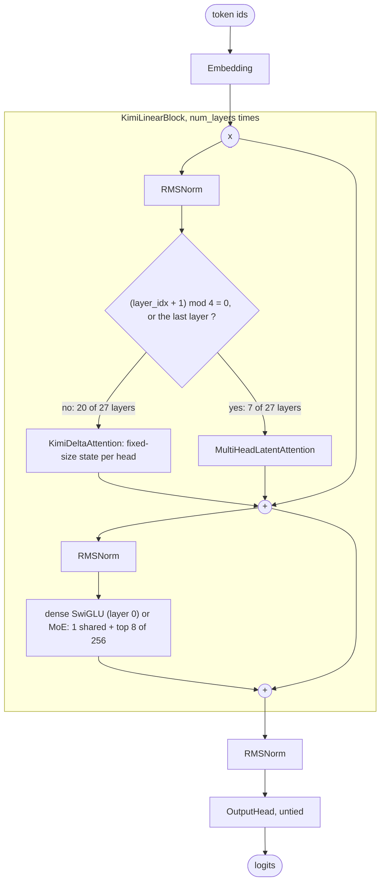

# Kimi K2 and Kimi Linear Architectures

Moonshot AI's two 2025 model families take the [DeepSeek-V3](deepseek-v3.md) design in opposite directions. **Kimi K2** keeps it almost unchanged and scales it to one trillion parameters, with more experts and fewer attention heads. **Kimi Linear** replaces three of every four attention layers with **Kimi Delta Attention (KDA)**, a linear-attention layer whose memory does not grow with the context. This guide walks through both in OLM's source, maps their arguments to the Hugging Face `config.json` files, trains tiny versions on a CPU, and lists where OLM differs from the releases.

> [!NOTE]
> OLM presets are architectures with **randomly initialised weights**. `KimiK2_1T()` and `KimiLinear48BA3B()` build the released graphs; they do not download Moonshot's checkpoints. Build them on the `meta` device. See the [Model Zoo](index.md) for every preset and its measured size.

<div class="table-scroll">

| Preset | Release | Total parameters (OLM) | Active per token (OLM) |
|---|---|--:|--:|
| `KimiK2_1T` | Kimi K2 (Base and Instruct) | 1.03T | 32.9B |
| `KimiLinear48BA3B` | Kimi Linear 48B-A3B | 49.5B | 3.83B |

</div>

## Kimi K2

### What changed from DeepSeek-V3

Kimi K2 uses DeepSeek-V3's architecture: its released `config.json` names `DeepseekV3ForCausalLM`. The differences are all in the configuration. From the two released `config.json` files:

<div class="table-scroll">

| | DeepSeek-V3 | Kimi K2 |
|---|--:|--:|
| Routed experts per MoE layer | 256 | 384 |
| Routed experts per token | 8 | 8 |
| Attention heads | 128 | 64 |
| Dense layers before the first MoE layer | 3 | 1 |
| Expert groups (`n_group`) | 8 | 1 |
| Multi-token-prediction modules | 1 | 0 |
| `routed_scaling_factor` | 2.5 | 2.827 |
| Vocabulary | 129,280 | 163,840 |
| `rope_theta` | 10,000 | 50,000 |

</div>

- **More, equally small experts.** 384 routed experts with the same width (2,048) and the same 8 per token make the MoE sparser: each token uses 8 of 384 instead of 8 of 256, so total parameters grow to 1T while the active count stays near DeepSeek-V3's.
- **Half the attention heads.** Halving the heads from 128 to 64 almost halves MLA's parameters and its per-token compute, which matters most for long inputs.
- **One expert group.** With `n_group: 1`, experts are chosen from all 384 at once, which is what OLM's router does anyway.

### The source

The code in [`src/olm/models/moonshotai/kimi_k2.py`](https://github.com/openlanguagemodel/openlanguagemodel/blob/main/src/olm/models/moonshotai/kimi_k2.py) is DeepSeek-V3's with the MTP head removed: `KimiK2Block` builds the same `MultiHeadLatentAttention` and `MoEFeedForward` with sigmoid, `noaux_tc` routing, and `KimiK2Model` has the same custom `forward`. The [DeepSeek-V3 guide](deepseek-v3.md#the-source-section-by-section) walks through that code. What is specific to Kimi K2 is the preset:

[`kimi_k2.py` lines 244–269](https://github.com/openlanguagemodel/openlanguagemodel/blob/main/src/olm/models/moonshotai/kimi_k2.py#L244-L269)

```python
class KimiK2_1T(KimiK2Model):
    """Kimi K2 (1T total, ~32B active; language-model component)."""

    def __init__(self):
        super().__init__(
            vocab_size=163840,
            embed_dim=7168,
            num_layers=61,
            num_heads=64,
            max_seq_len=131072,
            kv_lora_rank=512,
            qk_nope_head_dim=128,
            qk_rope_head_dim=64,
            v_head_dim=128,
            q_lora_rank=1536,
            dense_intermediate_size=18432,
            moe_intermediate_size=2048,
            num_experts=384,
            num_shared_experts=1,
            top_k=8,
            first_k_dense_replace=1,
            routed_scaling_factor=2.827,
            rope_theta=10000.0,
            rms_norm_eps=1e-6,
            tie_weights=False,
        )
```

### Where the 1.03T parameters are, and the 32.9B a token uses

<div class="table-scroll">

| Part | Parameters |
|---|--:|
| Embedding and untied output head, 163,840 × 7,168 each | 2 × 1,174,405,120 |
| MLA per layer (64 heads; DeepSeek-V3's 128 heads: 187,107,328) | 101,124,096 |
| One expert, 3 × 7,168 × 2,048 | 44,040,192 |
| One MoE layer (MLA + 384 routed + 1 shared expert + router + 2 RMSNorms) | 17,059,365,632 |
| **Total**: 1 dense + 60 MoE layers + embedding + head + final norm | **1,026,408,255,488** |
| **Active per token**: total − 60 × 376 unused experts × 44,040,192 | **32,861,523,968** |

</div>

### Configuration: OLM and Hugging Face

Values for `KimiK2_1T` next to the released [`config.json`](https://huggingface.co/moonshotai/Kimi-K2-Base/blob/main/config.json). Bold rows differ.

<div class="table-scroll">

| OLM argument | Hugging Face key | `KimiK2_1T` | Release |
|---|---|--:|--:|
| `vocab_size` | `vocab_size` | 163840 | 163840 |
| `embed_dim` | `hidden_size` | 7168 | 7168 |
| `num_layers` | `num_hidden_layers` | 61 | 61 |
| `num_heads` | `num_attention_heads` | 64 | 64 |
| `max_seq_len` | `max_position_embeddings` | 131072 | 131072 |
| `kv_lora_rank`, `q_lora_rank` | `kv_lora_rank`, `q_lora_rank` | 512, 1536 | 512, 1536 |
| `qk_nope_head_dim`, `qk_rope_head_dim`, `v_head_dim` | same names | 128, 64, 128 | 128, 64, 128 |
| `dense_intermediate_size` | `intermediate_size` | 18432 | 18432 |
| `moe_intermediate_size` | `moe_intermediate_size` | 2048 | 2048 |
| `num_experts` | `n_routed_experts` | 384 | 384 |
| `num_shared_experts` | `n_shared_experts` | 1 | 1 |
| `top_k` | `num_experts_per_tok` | 8 | 8 |
| `first_k_dense_replace` | `first_k_dense_replace` | 1 | 1 |
| `routed_scaling_factor` | `routed_scaling_factor` | 2.827 | 2.827 |
| no MTP head | `num_nextn_predict_layers` | 0 | 0 |
| **`rope_theta`** | **`rope_theta`** | **10000.0** | **50000.0** |
| `rms_norm_eps` | `rms_norm_eps` | 1e-6 | 1e-6 |
| `tie_weights` | `tie_word_embeddings` | false | false |
| fixed in the block | `scoring_func`, `topk_method` | sigmoid, noaux_tc | sigmoid, noaux_tc |
| no group-limited routing | `n_group`, `topk_group` | — | 1, 1 |
| **not supported** | **`rope_scaling`** | **none** | **YaRN, factor 32** |

</div>

### Train a tiny Kimi K2 on your CPU

Training a Kimi K2 looks like training DeepSeek-V3 without the MTP loss. The auxiliary-loss-free bias still needs its manual update after each step:

```python
import torch
import torch.nn.functional as F
from olm.models import KimiK2Model

torch.manual_seed(0)
model = KimiK2Model(
    vocab_size=256,
    embed_dim=64,
    num_layers=3,
    num_heads=4,
    max_seq_len=64,
    kv_lora_rank=16,
    qk_nope_head_dim=16,
    qk_rope_head_dim=8,
    v_head_dim=16,
    q_lora_rank=32,
    dense_intermediate_size=128,
    moe_intermediate_size=32,
    num_experts=12,
    num_shared_experts=1,
    top_k=2,
    first_k_dense_replace=1,
    tie_weights=False,  # untied, as in the release
)
print(f"{sum(p.numel() for p in model.parameters()):,} parameters")
moe_blocks = [block for block in model.transformer_blocks if block.use_moe]

tokens = torch.randint(0, 256, (8, 33))
inputs, targets = tokens[:, :-1], tokens[:, 1:]
optimizer = torch.optim.AdamW(model.parameters(), lr=3e-3)

for step in range(30):
    logits = model(inputs)
    loss = F.cross_entropy(logits.flatten(0, 1), targets.flatten())
    optimizer.zero_grad()
    loss.backward()
    optimizer.step()
    for block in moe_blocks:
        block.ffn.router.update_expert_bias_(update_rate=1e-2)
    if step % 10 == 0 or step == 29:
        print(f"step {step:2d}  loss {loss.item():.3f}")
```

Output on a CPU with PyTorch 2.12 (losses vary slightly across versions and hardware):

```text
257,664 parameters
step  0  loss 5.706
step 10  loss 2.371
step 20  loss 0.751
step 29  loss 0.208
```

## Kimi Linear

### What changed from Kimi K2

Kimi Linear 48B-A3B is a much smaller model (49.5B total, 3.8B active in OLM's count) whose main change is the attention:

- **A 3:1 hybrid of linear and full attention.** Layers 4, 8, 12, 16, 20, 24 and 27 (counting from 1) use MLA; the other 20 use KDA. The last layer is always full attention, which is why the schedule ends 24, 27 rather than 24, 28.
- **KDA keeps a fixed-size state.** A KDA head compresses everything it has read into a `head_dim × head_dim` matrix that it updates once per token, so its memory and per-token cost do not grow with the context. Only the seven MLA layers keep a KV cache.
- **A per-channel forget gate.** KDA builds on Gated DeltaNet, whose state decays by one scalar per head at each step. KDA gives every key channel its own decay rate, so different parts of the state can forget at different speeds.
- **MLA without positions.** The release sets `mla_use_nope: true`: its MLA layers apply no rotary embedding, and the model relies on the KDA layers for position information. OLM's MLA always applies RoPE (see [Known differences](#known-differences-from-the-reference)).
- **The MoE is K2's recipe at a smaller size:** 256 routed experts of width 1,024, 8 per token, one shared expert, sigmoid scoring with `routed_scaling_factor` 2.446, and one dense layer first.



### The source, section by section

Kimi Linear lives in [`src/olm/models/moonshotai/kimi_linear.py`](https://github.com/openlanguagemodel/openlanguagemodel/blob/main/src/olm/models/moonshotai/kimi_linear.py), and its linear attention in [`src/olm/nn/attention/kda.py`](https://github.com/openlanguagemodel/openlanguagemodel/blob/main/src/olm/nn/attention/kda.py).

#### The layer schedule

[`kimi_linear.py` lines 247–278](https://github.com/openlanguagemodel/openlanguagemodel/blob/main/src/olm/models/moonshotai/kimi_linear.py#L247-L278)

```python
layers = Block(
    [
        KimiLinearBlock(
            embed_dim,
            is_full_attention=(
                (layer_idx + 1) % full_attention_interval == 0
                or layer_idx == num_layers - 1
            ),
            use_moe=layer_idx >= first_k_dense_replace,
            kda_num_heads=kda_num_heads,
            kda_head_dim=kda_head_dim,
            kda_conv_kernel_size=kda_conv_kernel_size,
            mla_num_heads=mla_num_heads,
            max_seq_len=max_seq_len,
            kv_lora_rank=kv_lora_rank,
            qk_nope_head_dim=qk_nope_head_dim,
            qk_rope_head_dim=qk_rope_head_dim,
            v_head_dim=v_head_dim,
            q_lora_rank=q_lora_rank,
            rope_theta=rope_theta,
            intermediate_size=intermediate_size,
            moe_intermediate_size=moe_intermediate_size,
            num_experts=num_experts,
            num_shared_experts=num_shared_experts,
            top_k=top_k,
            routed_scaling_factor=routed_scaling_factor,
            dropout=dropout,
            rms_norm_eps=rms_norm_eps,
        )
        for layer_idx in range(num_layers)
    ]
)
```

- **`is_full_attention=((layer_idx + 1) % full_attention_interval == 0 or layer_idx == num_layers - 1)`** gives MLA at zero-based layers 3, 7, 11, 15, 19, 23 and 26, which is the release's `full_attn_layers` list `[4, 8, 12, 16, 20, 24, 27]` counted from one.
- Unlike DeepSeek-V3 and Kimi K2, the layers are a plain `Block` of per-layer `KimiLinearBlock`s, with no custom `forward`: every sublayer here returns a single tensor.

#### The block

[`kimi_linear.py` lines 121–166](https://github.com/openlanguagemodel/openlanguagemodel/blob/main/src/olm/models/moonshotai/kimi_linear.py#L121-L166)

```python
if is_full_attention:
    attn = MultiHeadLatentAttention(
        embed_dim,
        mla_num_heads,
        max_seq_len,
        kv_lora_rank=kv_lora_rank,
        qk_nope_head_dim=qk_nope_head_dim,
        qk_rope_head_dim=qk_rope_head_dim,
        v_head_dim=v_head_dim,
        q_lora_rank=q_lora_rank,
        dropout=dropout,
        rope_theta=rope_theta,
        rms_norm_eps=rms_norm_eps,
    )
else:
    attn = KimiDeltaAttention(
        embed_dim,
        num_heads=kda_num_heads,
        head_dim=kda_head_dim,
        conv_kernel_size=kda_conv_kernel_size,
        dropout=dropout,
    )

if use_moe:
    ffn = SwiGLUMoEFFN(
        embed_dim,
        num_experts=num_experts,
        num_shared_experts=num_shared_experts,
        top_k=top_k,
        hidden_dim=moe_intermediate_size,
        bias=False,
    )
    # Kimi Linear scores experts with sigmoid + a routed-output scale,
    # not the plain softmax SwiGLUMoEFFN builds by default.
    ffn.router = KimiLinearRouter(
        embed_dim, num_experts, top_k, routed_scaling_factor
    )
else:
    ffn = SwiGLUFFN(embed_dim, hidden_dim=intermediate_size, bias=False)

super().__init__(
    [
        Residual(Block([RMSNorm(embed_dim, eps=rms_norm_eps), attn])),
        Residual(Block([RMSNorm(embed_dim, eps=rms_norm_eps), ffn])),
    ]
)
```

- The block picks its attention and its feed-forward in `__init__`, then hands both to the standard `Residual(Block([RMSNorm, sublayer]))` pattern.
- **`q_lora_rank=None`** in the preset makes MLA project queries directly (`q_proj`), without DeepSeek-V3's low-rank query compression.
- The MoE is a `SwiGLUMoEFFN` whose router is replaced after construction by `KimiLinearRouter`:

[`kimi_linear.py` lines 40–55](https://github.com/openlanguagemodel/openlanguagemodel/blob/main/src/olm/models/moonshotai/kimi_linear.py#L40-L55)

```python
def forward(self, x: torch.Tensor) -> tuple[torch.Tensor, torch.Tensor]:
    """Route each token to its top-k experts using scaled sigmoid scores.

    Args:
        x (torch.Tensor): Hidden states shaped ``[batch, seq_len, embed_dim]``.

    Returns:
        tuple[torch.Tensor, torch.Tensor]: Expert indices and routing
        weights, both shaped ``[batch, seq_len, top_k]``.
    """
    logits = self.gate(x)
    scores = torch.sigmoid(logits)
    top_k_scores, top_k_indices = torch.topk(scores, self.top_k, dim=-1)
    top_k_weights = top_k_scores / top_k_scores.sum(dim=-1, keepdim=True)
    top_k_weights = top_k_weights * self.routed_scaling_factor
    return top_k_indices, top_k_weights
```

Sigmoid scores, top 8, renormalised to sum to 1 and scaled by 2.446: the same recipe as Kimi K2, without the balancing bias.

#### Kimi Delta Attention

The gates and projections:

[`kda.py` lines 68–84](https://github.com/openlanguagemodel/openlanguagemodel/blob/main/src/olm/nn/attention/kda.py#L68-L84)

```python
x_conv = self.conv(x)
x_conv = F.silu(x_conv)

alpha = torch.sigmoid(
    self.alpha_proj(x_conv).view(B, N, self.num_key_heads, self.key_head_dim)
)
beta = torch.sigmoid(self.beta_proj(x_conv))

q = self.q_proj(x).view(B, N, self.num_key_heads, self.key_head_dim)
k = self.k_proj(x).view(B, N, self.num_key_heads, self.key_head_dim)
v = self.v_proj(x).view(B, N, self.num_value_heads, self.value_head_dim)

q = self.q_norm(q)
k = self.k_norm(k)

q = F.normalize(q, p=2, dim=-1)
k = F.normalize(k, p=2, dim=-1)
```

- A short causal convolution (kernel 4) mixes each position with the three before it; the gates are computed from its output.
- **`alpha`** is the forget gate, one value in (0, 1) for every key channel of every head (`[batch, seq, heads, head_dim]`). This is KDA's change to Gated DeltaNet, whose `alpha` has one value per head.
- **`beta`** is a per-head write strength in (0, 1).
- Queries and keys go through a per-head RMSNorm and are then L2-normalised, so every key has unit length.

The recurrence, run for each head:

[`kda.py` lines 102–124](https://github.com/openlanguagemodel/openlanguagemodel/blob/main/src/olm/nn/attention/kda.py#L102-L124)

```python
    S = torch.zeros(B, self.key_head_dim, v_dim, device=x.device, dtype=x.dtype)
    outs = []

    for t in range(N):
        k_t = k_h[:, t].unsqueeze(-1)
        v_t = v_h[:, t].unsqueeze(1)
        a_t = alpha_h[:, t].unsqueeze(-1)  # [B, key_head_dim, 1]
        b_t = beta_h[:, t].unsqueeze(-1)

        S = a_t * S + b_t * torch.bmm(k_t, v_t)

        q_t = q_h[:, t].unsqueeze(1)
        o_t = torch.bmm(q_t, S).squeeze(1)
        outs.append(o_t)

    output_heads.append(torch.stack(outs, dim=1))

out = torch.cat(output_heads, dim=-1)

gate = torch.sigmoid(self.output_gate(x))
out = out * gate

out = self.out_proj(out)
```

- `S` is the head's state, a `head_dim × head_dim` matrix (128 × 128 in the preset). Each step decays it channel by channel with `a_t`, adds the new key-value outer product scaled by `b_t`, and reads it out with the query.
- The loop runs over positions one at a time, so its memory is constant in the sequence length. That is the point of linear attention, and also why this reference implementation is slow: production implementations compute the same recurrence in chunks with fused kernels.
- The output is multiplied by a sigmoid gate computed from the layer input, then projected back to `embed_dim`.

#### The preset

[`kimi_linear.py` lines 295–324](https://github.com/openlanguagemodel/openlanguagemodel/blob/main/src/olm/models/moonshotai/kimi_linear.py#L295-L324)

```python
class KimiLinear48BA3B(KimiLinearModel):
    """Kimi Linear 48B-A3B (48B total, 256-expert MoE, ~3B active per token)."""

    def __init__(self):
        super().__init__(
            vocab_size=163840,
            embed_dim=2304,
            num_layers=27,
            kda_num_heads=32,
            kda_head_dim=128,
            kda_conv_kernel_size=4,
            mla_num_heads=32,
            max_seq_len=1048576,
            kv_lora_rank=512,
            qk_nope_head_dim=128,
            qk_rope_head_dim=64,
            v_head_dim=128,
            q_lora_rank=None,
            intermediate_size=9216,
            moe_intermediate_size=1024,
            num_experts=256,
            num_shared_experts=1,
            top_k=8,
            full_attention_interval=4,
            first_k_dense_replace=1,
            rope_theta=10000.0,
            routed_scaling_factor=2.446,
            rms_norm_eps=1e-5,
            tie_weights=False,
        )
```

At this size, a KDA layer (56.7M parameters) is larger than an MLA layer (29.1M), because each of its five input projections maps 2,304 to 32 heads × 128 = 4,096. The linear layers cost parameters; what they save is the KV cache and the quadratic attention compute.

### Configuration: OLM and Hugging Face

Values for `KimiLinear48BA3B` next to the released [`config.json`](https://huggingface.co/moonshotai/Kimi-Linear-48B-A3B-Base/blob/main/config.json). Bold rows differ.

<div class="table-scroll">

| OLM argument | Hugging Face key | `KimiLinear48BA3B` | Release |
|---|---|--:|--:|
| `vocab_size` | `vocab_size` | 163840 | 163840 |
| `embed_dim` | `hidden_size` | 2304 | 2304 |
| `num_layers` | `num_hidden_layers` | 27 | 27 |
| `kda_num_heads` | `linear_attn_config.num_heads` | 32 | 32 |
| `kda_head_dim` | `linear_attn_config.head_dim` | 128 | 128 |
| `kda_conv_kernel_size` | `linear_attn_config.short_conv_kernel_size` | 4 | 4 |
| `full_attention_interval` (+ last layer) | `linear_attn_config.full_attn_layers` | 4 | `[4, 8, …, 24, 27]` |
| `mla_num_heads` | `num_attention_heads` | 32 | 32 |
| `max_seq_len` | `model_max_length` | 1048576 | 1048576 |
| `kv_lora_rank` | `kv_lora_rank` | 512 | 512 |
| `q_lora_rank` | `q_lora_rank` | None | null |
| `qk_nope_head_dim`, `qk_rope_head_dim`, `v_head_dim` | same names | 128, 64, 128 | 128, 64, 128 |
| `intermediate_size` | `intermediate_size` | 9216 | 9216 |
| `moe_intermediate_size` | `moe_intermediate_size` | 1024 | 1024 |
| `num_experts` | `num_experts` | 256 | 256 |
| `num_shared_experts` | `num_shared_experts` | 1 | 1 |
| `top_k` | `num_experts_per_token` | 8 | 8 |
| `first_k_dense_replace` | `first_k_dense_replace` | 1 | 1 |
| `routed_scaling_factor` | `routed_scaling_factor` | 2.446 | 2.446 |
| fixed in `KimiLinearRouter` | `moe_router_activation_func`, `moe_renormalize` | sigmoid, true | sigmoid, true |
| `rope_theta` | `rope_theta` | 10000.0 | 10000.0 |
| **MLA always applies RoPE** | **`mla_use_nope`** | **false** | **true** |
| `rms_norm_eps` | `rms_norm_eps` | 1e-5 | 1e-5 |
| `tie_weights` | `tie_word_embeddings` | false | false |

</div>

### Train a tiny Kimi Linear on your CPU

Four layers with `full_attention_interval=4` give three KDA layers and one MLA layer, the release's ratio:

```python
import torch
import torch.nn.functional as F
from olm.models import KimiLinearModel

torch.manual_seed(0)
model = KimiLinearModel(
    vocab_size=256,
    embed_dim=64,
    num_layers=4,
    kda_num_heads=2,
    kda_head_dim=16,
    kda_conv_kernel_size=4,
    mla_num_heads=4,
    max_seq_len=64,
    kv_lora_rank=16,
    qk_nope_head_dim=16,
    qk_rope_head_dim=8,
    v_head_dim=16,
    q_lora_rank=None,
    intermediate_size=128,
    moe_intermediate_size=32,
    num_experts=8,
    num_shared_experts=1,
    top_k=2,
    tie_weights=False,  # untied, as in the release
)
print(f"{sum(p.numel() for p in model.parameters()):,} parameters")
for i, layer in enumerate(model.blocks[1].blocks):
    print(i, type(layer.blocks[0].block.blocks[1]).__name__)

tokens = torch.randint(0, 256, (8, 33))
inputs, targets = tokens[:, :-1], tokens[:, 1:]
optimizer = torch.optim.AdamW(model.parameters(), lr=3e-3)

for step in range(30):
    logits = model(inputs)
    loss = F.cross_entropy(logits.flatten(0, 1), targets.flatten())
    optimizer.zero_grad()
    loss.backward()
    optimizer.step()
    if step % 10 == 0 or step == 29:
        print(f"step {step:2d}  loss {loss.item():.3f}")
```

Output on a CPU with PyTorch 2.12 (losses vary slightly across versions and hardware):

```text
277,590 parameters
0 KimiDeltaAttention
1 KimiDeltaAttention
2 KimiDeltaAttention
3 MultiHeadLatentAttention
step  0  loss 5.750
step 10  loss 2.344
step 20  loss 0.854
step 29  loss 0.263
```

Like `Qwen3Model`, Kimi Linear's MoE layers return only their output. To add a load-balancing loss, capture the router logits with a forward hook on each `router.gate`, as in the [Qwen3 training example](qwen-3.md#train-a-tiny-qwen3-moe-on-your-cpu).

## Known differences from the reference

Kimi K2:

- **RoPE base and scaling.** The release uses `rope_theta: 50000.0` with YaRN scaling (factor 32 from a 4,096-token original context). `KimiK2_1T` passes `rope_theta=10000.0` and OLM applies plain RoPE, as the docstring of `KimiK2Model` notes for the scaling.
- **DeepSeek-V3's routing differences apply**: the router's gate has a learned bias the release does not have, and `update_expert_bias_` moves each expert's bias in proportion to its imbalance rather than by a fixed step. See the [DeepSeek-V3 guide](deepseek-v3.md#known-differences-from-the-reference). Group-limited routing is not a difference here, because the release uses a single group.

Kimi Linear:

- **No delta rule.** In Gated DeltaNet and in KDA as published, each write first removes what the state already predicts for the key, `S ← (I − β k kᵀ) Diag(α) S + β k vᵀ` (up to the orientation of `S`), so that (with β = 1) writing the same key twice replaces its value instead of adding to it. OLM's recurrence (`S = a_t * S + b_t * k_t v_tᵀ` in the excerpt above) omits the `− β k kᵀ` correction, so it computes gated linear attention with KDA's gates rather than the delta rule. `GatedDeltaNet` in `olm/nn/attention/gated_deltanet.py` uses the same update.
- **A different KDA parameterisation.** The reference applies short causal convolutions with SiLU to the projected queries, keys and values; computes the forget gate from low-rank projections with learned `A_log` and `dt_bias` terms; computes `beta` from the layer input; and gates the output through a gated RMSNorm. OLM convolves the layer input, computes both gates from it with full-rank projections, projects queries, keys and values from the unconvolved input, and multiplies the output by a sigmoid gate without a norm.
- **RoPE in MLA.** The release's MLA layers use no positional encoding (`mla_use_nope: true`; its modelling code asserts it). OLM's `MultiHeadLatentAttention` always rotates the 64-dimensional `qk_rope_head_dim` slice.
- **No balancing bias in the router.** The release's router adds an `e_score_correction_bias` to the scores when choosing experts, as DeepSeek-V3 does. `KimiLinearRouter` has none, and its logits are not returned, so there is also no auxiliary loss unless you add one.
- **Speed.** KDA runs a Python loop over every position and head. It is meant to be read and to train tiny models; the reference uses chunked kernels (`chunk_kda` from the flash-linear-attention library).

Both families use PyTorch's default initialisers, and neither preset includes a tokenizer or weight loading.

## Further reading

- *Kimi K2: Open Agentic Intelligence*, Kimi Team, 2025. [arXiv:2507.20534](https://arxiv.org/abs/2507.20534)
- *Kimi Linear: An Expressive, Efficient Attention Architecture*, Kimi Team, 2025. [arXiv:2510.26692](https://arxiv.org/abs/2510.26692)
- *Gated Delta Networks: Improving Mamba2 with Delta Rule*, Yang, Kautz and Hatamizadeh, 2024. [arXiv:2412.06464](https://arxiv.org/abs/2412.06464)
- Previous: [DeepSeek-V3](deepseek-v3.md), whose code Kimi K2 reuses.

<!-- model-zoo: KimiK2Model KimiLinearModel -->
