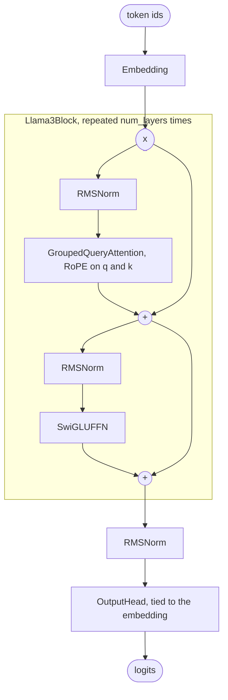

# Llama 3 Architecture

Llama 3 (Meta, 2024) is a dense decoder-only transformer built from pre-norm blocks of grouped-query attention with rotary positions and a SwiGLU feed-forward, with RMSNorm throughout. This guide walks through OLM's `Llama3Model` line by line, maps every argument to the Hugging Face `config.json`, trains a tiny version on a CPU, and lists where OLM differs from Meta's release.

> [!NOTE]
> OLM presets are architectures with **randomly initialised weights**. `Llama3_1_8B()` builds the Llama 3.1 8B graph; it does not download Meta's checkpoint. See the [Model Zoo](index.md) for every preset and its measured size.

<div class="table-scroll">

| Preset | Release | Total parameters (OLM) |
|---|---|--:|
| `Llama3_1_405B` | Llama 3.1 405B | 403.8B |
| `Llama3_1_70B` | Llama 3.1 70B | 69.5B |
| `Llama3_1_8B` | Llama 3.1 8B | 7.50B |
| `Llama3_2_3B` | Llama 3.2 3B | 3.21B |
| `Llama3_2_1B` | Llama 3.2 1B | 1.24B |

</div>

The 3.1 presets tie the output head to the embedding, which the 3.1 releases do not; that is why `Llama3_1_8B` counts 7.50B rather than 8.03B. [Known differences](#known-differences-from-the-reference) explains this and how to build the untied model.

## What changed from Llama 2

The block is the same as Llama 2's. What changed is its configuration, which OLM's `Llama2_7B` and `Llama3_1_8B` presets show side by side:

<div class="table-scroll">

| | `Llama2_7B` | `Llama3_1_8B` |
|---|--:|--:|
| Vocabulary | 32,000 | 128,256 |
| Hidden size | 4,096 | 4,096 |
| FFN hidden size | 11,008 | 14,336 |
| Query / key-value heads | 32 / 32 (MHA) | 32 / 8 (GQA) |
| Context (`max_seq_len`) | 4,096 | 131,072 |
| RoPE base (`rope_theta`) | 10,000 | 500,000 |

</div>

- **A 4× larger vocabulary.** Llama 3 moved from a 32K SentencePiece vocabulary to a 128K one, so the same text becomes fewer tokens. At 8B the embedding matrix alone is 525M parameters.
- **Grouped-query attention at every size.** Among the released Llama 2 models only the 70B used GQA; the 7B and 13B use full multi-head attention. In Llama 3 every size shares each key/value head between several query heads (4 at 8B), which shrinks the KV cache that inference has to keep.
- **A higher RoPE base and longer context.** `rope_theta` went from 10,000 to 500,000, which slows the rotation of the lowest frequencies. Llama 3.1 then extended the context to 128K tokens with a frequency-dependent RoPE rescaling that OLM does not apply (see [Known differences](#known-differences-from-the-reference)).

## Block diagram



Each `+` adds a sublayer's input back to its output (a residual connection). Every arrow carries a tensor shaped `[batch, seq_len, embed_dim]` until the head turns it into `[batch, seq_len, vocab_size]` logits.

## The source, section by section

All of Llama 3 lives in one file, [`src/olm/models/meta/llama3.py`](https://github.com/openlanguagemodel/openlanguagemodel/blob/main/src/olm/models/meta/llama3.py). It has three parts: a block, a model that stacks blocks, and presets that fill in the released numbers.

### The decoder block

[`llama3.py` lines 40–72](https://github.com/openlanguagemodel/openlanguagemodel/blob/main/src/olm/models/meta/llama3.py#L40-L72)

```python
super().__init__(
    [
        Residual(
            Block(
                [
                    RMSNorm(embed_dim, eps=1e-5),
                    GroupedQueryAttention(
                        embed_dim,
                        num_heads,
                        num_kv_heads,
                        max_seq_len,
                        dropout=dropout,
                        rope_theta=rope_theta,
                        use_bias=False,
                    ),
                ]
            )
        ),
        Residual(
            Block(
                [
                    RMSNorm(embed_dim, eps=1e-5),
                    SwiGLUFFN(
                        embed_dim,
                        hidden_dim=intermediate_size,
                        dropout=dropout,
                        bias=False,
                    ),
                ]
            )
        ),
    ]
)
```

- **`Residual(Block([...]))`** is the whole pre-norm pattern. `Block` runs its children in order, and `Residual` adds the input back, so the first entry computes `x + GQA(RMSNorm(x))` and the second computes `x + SwiGLU(RMSNorm(x))`. There is no custom `forward`.
- **`GroupedQueryAttention(embed_dim, num_heads, num_kv_heads, max_seq_len, ...)`** projects queries to `num_heads` heads and keys and values to `num_kv_heads` heads. It applies RoPE to queries and keys, then repeats each key/value head across its group of query heads before calling `scaled_dot_product_attention` with a causal mask. `max_seq_len` sizes the RoPE cache. `use_bias=False` removes the bias from the output projection (the query, key and value projections have no bias unless `qkv_bias=True`), as in Llama.
- **`SwiGLUFFN(embed_dim, hidden_dim=intermediate_size, bias=False)`** computes `down_proj(value * SiLU(gate))`, where `value` and `gate` are the two halves of one fused `up_proj` of width `2 * intermediate_size`. A Llama 3 FFN therefore holds three `embed_dim x intermediate_size` matrices' worth of weights.
- **`RMSNorm(embed_dim, eps=1e-5)`** has a learned scale and no bias or mean subtraction. Llama 3's epsilon is fixed at `1e-5` here; later families in OLM take `rms_norm_eps` as an argument.

### The model

[`llama3.py` lines 95–133](https://github.com/openlanguagemodel/openlanguagemodel/blob/main/src/olm/models/meta/llama3.py#L95-L133)

```python
def __init__(
    self,
    vocab_size: int,
    embed_dim: int,
    intermediate_size: int,
    num_layers: int,
    num_heads: int,
    num_kv_heads: int,
    max_seq_len: int,
    rope_theta: float = 500000.0,
    dropout: float = 0.0,
    tie_weights: bool = True,
):
    embedding = Embedding(vocab_size, embed_dim)
    super().__init__(
        [
            embedding,
            Repeat(
                lambda: Llama3Block(
                    embed_dim,
                    intermediate_size,
                    num_heads,
                    num_kv_heads,
                    max_seq_len,
                    dropout,
                    rope_theta,
                ),
                num_layers,
            ),
            RMSNorm(embed_dim, eps=1e-5),
            OutputHead(
                embed_dim,
                vocab_size,
                tied_embedding=embedding,
                tie_weights=tie_weights,
                use_norm=False,
            ),
        ]
    )
```

- The model is itself a `Block` of four children: embedding, `Repeat`, final norm and head. `model.blocks[0]` is the embedding and `model.blocks[3]` is the head.
- **`Repeat(lambda: Llama3Block(...), num_layers)`** calls the lambda `num_layers` times, so every layer gets its own weights. The layers are identical, which is why Llama needs no per-layer flags.
- **`OutputHead(..., tied_embedding=embedding, tie_weights=tie_weights, use_norm=False)`** projects to the vocabulary. With `tie_weights=True` (the default) it computes `F.linear(hidden, embedding.weight)`, so the head adds no parameters. With `tie_weights=False` it owns a separate `vocab_size x embed_dim` matrix. `use_norm=False` because the final `RMSNorm` is already the previous child.
- `rope_theta` defaults to 500,000 and `dropout` to 0.0. Pretraining a modern LLM usually uses no dropout.

### A preset

[`llama3.py` lines 171–184](https://github.com/openlanguagemodel/openlanguagemodel/blob/main/src/olm/models/meta/llama3.py#L171-L184)

```python
class Llama3_1_8B(Llama3Model):
    """Llama 3.1 8B Model."""

    def __init__(self):
        super().__init__(
            vocab_size=128256,
            embed_dim=4096,
            intermediate_size=14336,
            num_layers=32,
            num_heads=32,
            num_kv_heads=8,
            max_seq_len=131072,
            rope_theta=500000.0,
        )
```

A preset is a subclass whose `__init__` takes no arguments and passes the released values to the base class. Nothing else changes between sizes, so the 1B and the 405B models run the same code.

### Where the 7.50B parameters are

Building `Llama3_1_8B` on the `meta` device (shapes only, no memory) and counting each part gives:

<div class="table-scroll">

| Part | Shape | Parameters |
|---|---|--:|
| Embedding (shared with the head) | 128,256 × 4,096 | 525,336,576 |
| Attention per layer | q and out 4,096 × 4,096, k and v 4,096 × 1,024 | 41,943,040 |
| SwiGLU FFN per layer | 3 × 4,096 × 14,336 | 176,160,768 |
| RMSNorms per layer | 2 × 4,096 | 8,192 |
| 32 layers | | 6,979,584,000 |
| Final RMSNorm | 4,096 | 4,096 |
| **Total (tied head)** | | **7,504,924,672** |
| Untied head (`tie_weights=False`) | + 128,256 × 4,096 | 8,030,261,248 |

</div>

GQA is visible in the attention row: with 8 key/value heads, the key and value projections are a quarter the size of the query projection. The FFN holds about 80% of each layer's weights.

```python
import torch
from olm.models import Llama3Model, Llama3_1_8B

with torch.device("meta"):  # shapes only: no memory, no weights
    tied = Llama3_1_8B()
    untied = Llama3Model(
        vocab_size=128256,
        embed_dim=4096,
        intermediate_size=14336,
        num_layers=32,
        num_heads=32,
        num_kv_heads=8,
        max_seq_len=131072,
        rope_theta=500000.0,
        tie_weights=False,
    )

for name, model in [("tied", tied), ("untied", untied)]:
    print(f"{name}: {sum(p.numel() for p in model.parameters()):,}")
```

```text
tied: 7,504,924,672
untied: 8,030,261,248
```

## Configuration: OLM and Hugging Face

Values for `Llama3_1_8B` next to the released [`config.json`](https://huggingface.co/meta-llama/Llama-3.1-8B/blob/main/config.json). Bold rows differ.

<div class="table-scroll">

| OLM argument | Hugging Face key | `Llama3_1_8B` | Release |
|---|---|--:|--:|
| `vocab_size` | `vocab_size` | 128256 | 128256 |
| `embed_dim` | `hidden_size` | 4096 | 4096 |
| `intermediate_size` | `intermediate_size` | 14336 | 14336 |
| `num_layers` | `num_hidden_layers` | 32 | 32 |
| `num_heads` | `num_attention_heads` | 32 | 32 |
| `num_kv_heads` | `num_key_value_heads` | 8 | 8 |
| derived: `embed_dim // num_heads` | `head_dim` | 128 | 128 |
| `max_seq_len` | `max_position_embeddings` | 131072 | 131072 |
| `rope_theta` | `rope_theta` | 500000.0 | 500000.0 |
| fixed in the block: `eps=1e-5` | `rms_norm_eps` | 1e-5 | 1e-5 |
| fixed: `use_bias=False`, `bias=False` | `attention_bias`, `mlp_bias` | false | false |
| **`tie_weights`** | **`tie_word_embeddings`** | **true** | **false** |
| **not supported** | **`rope_scaling`** | **none** | **`llama3`, factor 8.0** |

</div>

For the Llama 3.2 presets the releases set `tie_word_embeddings: true`, which matches OLM, and use the same `llama3` RoPE scaling with factor 32.0.

## Train a tiny Llama 3 on your CPU

The base class takes every hyperparameter, so a Llama 3 small enough to train in seconds is just smaller numbers. This loop memorises one fixed batch of random tokens, which is enough to see the loss fall and to check that gradients reach every layer.

```python
import torch
import torch.nn.functional as F
from olm.models import Llama3Model

torch.manual_seed(0)
model = Llama3Model(
    vocab_size=256,
    embed_dim=64,
    intermediate_size=192,
    num_layers=2,
    num_heads=4,
    num_kv_heads=2,  # GQA: each key/value head serves two query heads
    max_seq_len=64,
    tie_weights=False,  # untied, as in the Llama 3.1 releases
)
print(f"{sum(p.numel() for p in model.parameters()):,} parameters")

tokens = torch.randint(0, 256, (8, 33))
inputs, targets = tokens[:, :-1], tokens[:, 1:]  # predict the next token
optimizer = torch.optim.AdamW(model.parameters(), lr=3e-3)

for step in range(30):
    logits = model(inputs)  # [8, 32, 256]
    loss = F.cross_entropy(logits.flatten(0, 1), targets.flatten())
    optimizer.zero_grad()
    loss.backward()
    optimizer.step()
    if step % 10 == 0 or step == 29:
        print(f"step {step:2d}  loss {loss.item():.3f}")
```

Output on a CPU with PyTorch 2.12 (losses vary slightly across versions and hardware):

```text
131,392 parameters
step  0  loss 5.762
step 10  loss 3.034
step 20  loss 1.055
step 29  loss 0.288
```

The first loss is close to ln(256) ≈ 5.55, the loss of a uniform guess over the vocabulary. To train on real text instead, pass the model to OLM's `Trainer`; [Datasets & Training](../guides/datasets-and-training.md) shows the data pipeline.

## Known differences from the reference

- **Tied output head on the 3.1 presets.** `Llama3_1_8B`, `Llama3_1_70B` and `Llama3_1_405B` keep the default `tie_weights=True`, but the Llama 3.1 releases set `tie_word_embeddings: false`. The presets therefore have one `vocab_size x embed_dim` matrix fewer than the release (525M parameters at 8B). Build the base class with `tie_weights=False` for the released parameter count, as in the example above. The 3.2 presets match their releases, which are tied. This is tracked in [issue #83](https://github.com/openlanguagemodel/openlanguagemodel/issues/83).
- **No Llama 3.1 RoPE scaling.** The releases rescale RoPE frequencies for long context (`rope_scaling.rope_type: "llama3"`, factor 8.0 for 3.1 and 32.0 for 3.2). `GroupedQueryAttention` always builds plain RoPE with base `rope_theta`, so positions beyond the original 8,192-token training context behave differently from Meta's checkpoints. OLM has the frequency-dependent rotation as `Llama3RotaryPositionalEmbedding` in `olm/nn/embeddings/positional/llama3_rope.py`, but `Llama3Block` does not use it. The docstring of `Llama3Model` notes this.
- **Initialisation.** OLM builds every layer with PyTorch's default initialisers. Meta's configs specify `initializer_range: 0.02` for the Hugging Face implementation. This matters only when you train from scratch and compare against a recipe that assumes that initialisation.
- **Architecture only.** There is no tokenizer, chat template or weight loading in the preset.

## Further reading

- *The Llama 3 Herd of Models*, Llama Team, AI @ Meta, 2024. [arXiv:2407.21783](https://arxiv.org/abs/2407.21783)
- [Grouped-query attention](https://arxiv.org/abs/2305.13245) (Ainslie et al., 2023) and [RoFormer / RoPE](https://arxiv.org/abs/2104.09864) (Su et al., 2021).
- [The Block System](../guides/architecture.md) explains `Block`, `Residual` and `Repeat`.
- Next: [Qwen3](qwen-3.md) adds QK-norm and a mixture-of-experts feed-forward to this block.

<!-- model-zoo: Llama3Model -->
