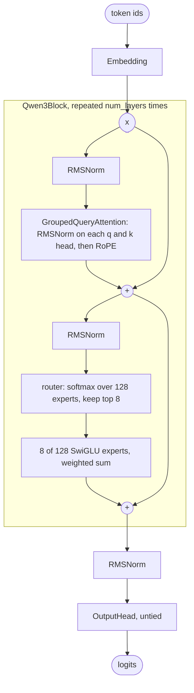

# Qwen3 Architecture

Qwen3 (Alibaba, 2025) keeps the Llama-style block and changes two things: it normalises queries and keys inside attention (QK-norm), and its flagship models replace the dense feed-forward with a mixture of 128 small experts, of which each token uses 8. This guide walks through OLM's `Qwen3Model`, the Qwen3 mixture-of-experts family, line by line: the source, the Hugging Face config mapping, a tiny MoE trained on a CPU with a load-balancing loss, and where OLM differs from the release.

> [!NOTE]
> OLM presets are architectures with **randomly initialised weights**. `Qwen3_235B_A22B()` builds the Qwen3-235B-A22B graph; it does not download Alibaba's checkpoint. Build it on the `meta` device unless you have the memory for 235 billion parameters. See the [Model Zoo](index.md) for every preset and its measured size.

<div class="table-scroll">

| Preset | Release | Total parameters (OLM) | Active per token (OLM) |
|---|---|--:|--:|
| `Qwen3_235B_A22B` | Qwen3-235B-A22B | 235.1B | 22.2B |

</div>

`Qwen3Model` is the MoE family only. The dense Qwen3 models (0.6B to 32B) are not presets; the [smaller MoE, Qwen3-30B-A3B](#build-qwen3-30b-a3b-from-the-base-class), is one call to the base class away.

## What changed from Qwen2.5

Compare OLM's `Qwen2Model` (Qwen2.5) with `Qwen3Model`:

- **QK-norm replaces QKV bias.** Qwen2.5 adds a bias to the query, key and value projections (`qkv_bias=True` in `qwen2.py`). Qwen3 removes it and instead applies an RMSNorm to each query and key head before RoPE (`use_qk_norm=True`). Normalising the per-head vectors keeps query and key magnitudes, and so the attention logits, in a controlled range; the Qwen3 report introduces it to keep training stable.
- **Head size decoupled from width.** Qwen3 fixes `head_dim=128` regardless of the hidden size. In the 235B model, 64 query heads × 128 = 8,192, twice the 4,096 hidden size, so `q_proj` maps 4,096 to 8,192 and `out_proj` maps back.
- **A fine-grained MoE feed-forward with no shared expert.** Every layer's FFN is 128 experts of width 1,536, with 8 chosen per token by a softmax router. The Qwen3 report notes that, unlike Qwen2.5-MoE, Qwen3's MoE models have no shared expert that every token passes through.
- **All layers are MoE.** There are no dense-first layers (the release's `mlp_only_layers` is empty and `decoder_sparse_step` is 1), so one `Qwen3Block` fits every layer.

## Block diagram



## The source, section by section

Qwen3 lives in [`src/olm/models/alibaba/qwen3.py`](https://github.com/openlanguagemodel/openlanguagemodel/blob/main/src/olm/models/alibaba/qwen3.py). The block is Llama 3's with QK-norm switched on and the dense FFN swapped for a mixture of experts.

### The decoder block

[`qwen3.py` lines 50–87](https://github.com/openlanguagemodel/openlanguagemodel/blob/main/src/olm/models/alibaba/qwen3.py#L50-L87)

```python
super().__init__(
    [
        Residual(
            Block(
                [
                    RMSNorm(embed_dim, eps=rms_norm_eps),
                    GroupedQueryAttention(
                        embed_dim,
                        num_heads,
                        num_kv_heads,
                        max_seq_len,
                        head_dim=head_dim,
                        dropout=dropout,
                        rope_theta=rope_theta,
                        use_bias=False,
                        use_qk_norm=True,
                        rms_norm_eps=rms_norm_eps,
                    ),
                ]
            )
        ),
        Residual(
            Block(
                [
                    RMSNorm(embed_dim, eps=rms_norm_eps),
                    SwiGLUMoEFFN(
                        embed_dim,
                        num_experts=num_experts,
                        num_shared_experts=0,
                        top_k=top_k,
                        hidden_dim=moe_intermediate_size,
                        bias=False,
                    ),
                ]
            )
        ),
    ]
)
```

- **`head_dim=head_dim`** overrides the default `embed_dim // num_heads`, which is how the 128-dimensional heads above fit a 4,096-wide model.
- **`use_qk_norm=True, rms_norm_eps=rms_norm_eps`** turns on the per-head RMSNorm. It is the only attention change from Llama 3.
- **`SwiGLUMoEFFN(embed_dim, num_experts=..., num_shared_experts=0, top_k=..., hidden_dim=moe_intermediate_size)`** replaces `SwiGLUFFN`. It builds `num_experts` independent `SwiGLUFFN` experts of width `moe_intermediate_size` and a router, and takes and returns `[batch, seq_len, embed_dim]`, so it drops into the same `Residual(Block([...]))` slot as a dense FFN.

Inside `GroupedQueryAttention`, QK-norm runs per head, before RoPE:

[`gqa.py` lines 161–168](https://github.com/openlanguagemodel/openlanguagemodel/blob/main/src/olm/nn/attention/gqa.py#L161-L168)

```python
# Apply QK Norm if enabled (per head, before RoPE)
if self.use_qk_norm:
    q = self.q_norm(q)
    k = self.k_norm(k)

if self.rope is not None:
    q = self.rope(q)
    k = self.rope(k)
```

`q` has shape `[batch, seq_len, num_heads, head_dim]` here, so `q_norm = RMSNorm(head_dim)` normalises each head's vector on its own.

### The router

`SwiGLUMoEFFN` routes with the `MoERouter` in `olm/nn/feedforward/moe_base.py`:

[`moe_base.py` lines 33–45](https://github.com/openlanguagemodel/openlanguagemodel/blob/main/src/olm/nn/feedforward/moe_base.py#L33-L45)

```python
# x: (batch_size, seq_len, embed_dim)
logits = self.gate(x) # (batch, seq, num_experts)

# Calculate routing weights
weights = F.softmax(logits, dim=-1)

# Select top-k experts
top_k_weights, top_k_indices = torch.topk(weights, self.top_k, dim=-1)

# Re-normalize weights
top_k_weights = top_k_weights / top_k_weights.sum(dim=-1, keepdim=True)

return top_k_indices, top_k_weights
```

- `self.gate` is a bias-free `Linear(embed_dim, num_experts)`: one logit per expert per token.
- The softmax runs over **all** experts, then `topk` keeps the 8 largest and renormalises them to sum to 1. This matches Qwen3's `norm_topk_prob: true`.
- The layer then loops over the experts, sends each one the tokens that chose it, and adds its output weighted by the routing weight. The loop is plain PyTorch, written for reading rather than speed.

### The model and the preset

[`qwen3.py` lines 141–170](https://github.com/openlanguagemodel/openlanguagemodel/blob/main/src/olm/models/alibaba/qwen3.py#L141-L170)

```python
embedding = Embedding(vocab_size, embed_dim)
super().__init__(
    [
        embedding,
        Repeat(
            lambda: Qwen3Block(
                embed_dim,
                moe_intermediate_size,
                num_heads,
                num_kv_heads,
                head_dim,
                max_seq_len,
                num_experts,
                top_k,
                dropout,
                rope_theta,
                rms_norm_eps,
            ),
            num_layers,
        ),
        RMSNorm(embed_dim, eps=rms_norm_eps),
        OutputHead(
            embed_dim,
            vocab_size,
            tied_embedding=embedding,
            tie_weights=tie_weights,
            use_norm=False,
        ),
    ]
)
```

[`qwen3.py` lines 173–191](https://github.com/openlanguagemodel/openlanguagemodel/blob/main/src/olm/models/alibaba/qwen3.py#L173-L191)

```python
class Qwen3_235B_A22B(Qwen3Model):
    """Qwen3-235B-A22B (235B total, ~22B active)."""

    def __init__(self):
        super().__init__(
            vocab_size=151936,
            embed_dim=4096,
            moe_intermediate_size=1536,
            num_layers=94,
            num_heads=64,
            num_kv_heads=4,
            max_seq_len=32768,
            num_experts=128,
            top_k=8,
            head_dim=128,
            rope_theta=1000000.0,
            rms_norm_eps=1e-6,
            tie_weights=False,
        )
```

The model is the Llama 3 layout (embedding, `Repeat` of identical blocks, final RMSNorm, head). The preset passes `tie_weights=False` because the release has a separate output matrix.

### Where the 235B parameters are, and the 22B a token uses

<div class="table-scroll">

| Part | Parameters |
|---|--:|
| Embedding, 151,936 × 4,096 | 622,329,856 |
| Output head (untied), 4,096 × 151,936 | 622,329,856 |
| Attention per layer (q 4,096 → 8,192, k and v 4,096 → 512, out 8,192 → 4,096, QK-norms) | 71,303,424 |
| One expert, 3 × 4,096 × 1,536 | 18,874,368 |
| 128 experts per layer | 2,415,919,104 |
| Router per layer, 4,096 × 128 | 524,288 |
| One layer (attention + router + experts + 2 RMSNorms) | 2,487,755,008 |
| **Total**: 94 layers + embedding + head + final norm | **235,093,634,560** |
| **Active per token**: total − 94 × 120 unused experts × 18,874,368 | **22,190,763,520** |

</div>

Experts hold 97% of the weights, but each token passes through 8 of 128 of them, which is how a 235B model costs about as much per token as a dense 22B one. Memory is another matter: every expert still has to be stored.

### Build Qwen3-30B-A3B from the base class

The smaller Qwen3 MoE uses the same code with the values from its [`config.json`](https://huggingface.co/Qwen/Qwen3-30B-A3B/blob/main/config.json):

```python
import torch
from olm.models import Qwen3Model

with torch.device("meta"):  # shapes only: no memory, no weights
    model = Qwen3Model(
        vocab_size=151936,
        embed_dim=2048,
        moe_intermediate_size=768,
        num_layers=48,
        num_heads=32,
        num_kv_heads=4,
        max_seq_len=40960,
        num_experts=128,
        top_k=8,
        head_dim=128,
        rope_theta=1000000.0,
        rms_norm_eps=1e-6,
        tie_weights=False,
    )

moe = model.blocks[1].stack[0].blocks[1].block.blocks[1]  # layer 0's SwiGLUMoEFFN
expert = sum(p.numel() for p in moe.experts[0].parameters())
total = sum(p.numel() for p in model.parameters())
active = total - 48 * (128 - 8) * expert  # 120 experts per layer sit idle
print(f"total {total / 1e9:.2f}B, active {active / 1e9:.2f}B")
```

```text
total 30.53B, active 3.35B
```

## Configuration: OLM and Hugging Face

Values for `Qwen3_235B_A22B` next to the released [`config.json`](https://huggingface.co/Qwen/Qwen3-235B-A22B/blob/main/config.json). Bold rows differ.

<div class="table-scroll">

| OLM argument | Hugging Face key | `Qwen3_235B_A22B` | Release |
|---|---|--:|--:|
| `vocab_size` | `vocab_size` | 151936 | 151936 |
| `embed_dim` | `hidden_size` | 4096 | 4096 |
| `moe_intermediate_size` | `moe_intermediate_size` | 1536 | 1536 |
| `num_layers` | `num_hidden_layers` | 94 | 94 |
| `num_heads` | `num_attention_heads` | 64 | 64 |
| `num_kv_heads` | `num_key_value_heads` | 4 | 4 |
| `head_dim` | `head_dim` | 128 | 128 |
| **`max_seq_len`** | **`max_position_embeddings`** | **32768** | **40960** |
| `num_experts` | `num_experts` | 128 | 128 |
| `top_k` | `num_experts_per_tok` | 8 | 8 |
| `rope_theta` | `rope_theta` | 1000000.0 | 1000000.0 |
| `rms_norm_eps` | `rms_norm_eps` | 1e-6 | 1e-6 |
| `tie_weights` | `tie_word_embeddings` | false | false |
| fixed: renormalised top-k | `norm_topk_prob` | true | true |
| fixed: `use_qk_norm=True`, no QKV bias | `attention_bias` | false | false |
| fixed: every layer is MoE | `mlp_only_layers`, `decoder_sparse_step` | `[]`, 1 | `[]`, 1 |
| **not applied** | **`router_aux_loss_coef`** | **—** | **0.001** |
| unused (no dense layers) | `intermediate_size` | — | 12288 |

</div>

## Train a tiny Qwen3 MoE on your CPU

A mixture of experts needs one thing a dense model does not: a load-balancing loss, so the router does not send every token to the same few experts. `SwiGLUMoEFFN` returns only its output, not its router logits, so this example captures the logits with a forward hook on each router's gate and adds OLM's `LoadBalanceLoss` with Qwen3's coefficient of 0.001.

```python
import torch
import torch.nn.functional as F
from olm.models import Qwen3Model
from olm.nn.feedforward.moe_base import MoERouter
from olm.train.losses import LoadBalanceLoss

torch.manual_seed(0)
num_experts, top_k = 8, 2
model = Qwen3Model(
    vocab_size=256,
    embed_dim=64,
    moe_intermediate_size=32,
    num_layers=2,
    num_heads=4,
    num_kv_heads=2,
    max_seq_len=64,
    num_experts=num_experts,
    top_k=top_k,
    head_dim=16,
    tie_weights=False,  # untied, as in the release
)
print(f"{sum(p.numel() for p in model.parameters()):,} parameters")

# Keep every router's logits from the latest forward pass.
router_logits = []
for module in model.modules():
    if isinstance(module, MoERouter):
        module.gate.register_forward_hook(lambda gate, args, out: router_logits.append(out))

balance = LoadBalanceLoss(num_experts=num_experts, top_k=top_k, coefficient=0.001)
tokens = torch.randint(0, 256, (8, 33))
inputs, targets = tokens[:, :-1], tokens[:, 1:]
optimizer = torch.optim.AdamW(model.parameters(), lr=3e-3)

for step in range(30):
    router_logits.clear()
    logits = model(inputs)
    lm_loss = F.cross_entropy(logits.flatten(0, 1), targets.flatten())
    aux_loss = sum(balance(r, r.topk(top_k, dim=-1).indices) for r in router_logits)
    loss = lm_loss + aux_loss
    optimizer.zero_grad()
    loss.backward()
    optimizer.step()
    if step % 10 == 0 or step == 29:
        print(f"step {step:2d}  lm {lm_loss.item():.3f}  balance {aux_loss.item():.5f}")

# Share of routing slots each expert received in the first MoE layer.
chosen = router_logits[0].topk(top_k, dim=-1).indices.flatten()
print((torch.bincount(chosen, minlength=num_experts) / chosen.numel()).tolist())
```

Output on a CPU with PyTorch 2.12 (values vary slightly across versions and hardware):

```text
157,056 parameters
step  0  lm 5.715  balance 0.00403
step 10  lm 3.140  balance 0.00405
step 20  lm 1.065  balance 0.00406
step 29  lm 0.267  balance 0.00406
[0.158203125, 0.0859375, 0.119140625, 0.08984375, 0.15625, 0.1171875, 0.1171875, 0.15625]
```

The balance term is 0.001 times the Switch loss summed over the two MoE layers, and each layer's Switch loss is 1.0 when routing is perfectly even, so perfectly balanced routing would read 0.002. The last line shows that all 8 experts in the first layer still receive work (an even split would be 0.125 each).

## Known differences from the reference

- **Router logits are not returned, so there is no auxiliary loss by default.** `SwiGLUMoEFFN` (through `MoEFeedForwardBase`) returns only the layer output. Training `Qwen3Model` with OLM's `Trainer` as is optimises next-token loss alone, with nothing to stop the router from collapsing onto a few experts. The release trains with a load-balancing loss (`router_aux_loss_coef: 0.001`), and the Qwen3 report describes computing it over the global batch rather than per micro-batch. Use a hook as above until the model exposes its router logits; this is tracked in [issue #82](https://github.com/openlanguagemodel/openlanguagemodel/issues/82). OLM's newer `olm.nn.moe.MoEFeedForward`, used by [DeepSeek-V3](deepseek-v3.md), does return them.
- **Context length.** The preset sets `max_seq_len=32768`; the release config sets `max_position_embeddings: 40960`. In OLM `max_seq_len` only sizes the RoPE cache, so it limits the longest sequence you can run, not the parameter count.
- **A reading-first MoE loop.** Experts run one after another in a Python loop over the tokens each one received. It is correct and easy to follow, but much slower than the grouped kernels production MoE implementations use, and there is no expert parallelism.
- **Initialisation.** OLM builds every layer with PyTorch's default initialisers; the release config specifies `initializer_range: 0.02` for the Hugging Face implementation.
- **Architecture only.** There is no tokenizer, chat template or weight loading.

## Further reading

- *Qwen3 Technical Report*, Qwen Team, 2025. [arXiv:2505.09388](https://arxiv.org/abs/2505.09388)
- *Switch Transformers*, Fedus et al., 2021, for the load-balancing loss `LoadBalanceLoss` implements. [arXiv:2101.03961](https://arxiv.org/abs/2101.03961)
- Previous: [Llama 3](llama-3.md), the dense block Qwen3 starts from. Next: [DeepSeek-V3](deepseek-v3.md), with shared experts, sigmoid routing and a balancing method that needs no auxiliary loss.

<!-- model-zoo: Qwen3Model -->
